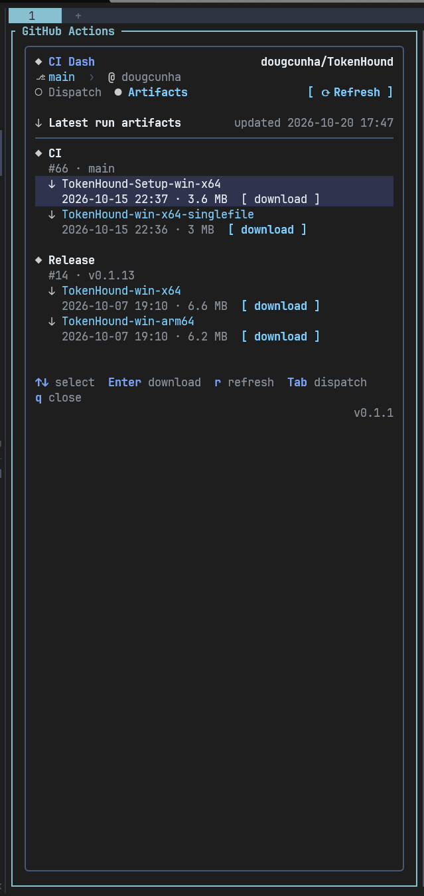

# Herdr Plugins

Small, sharp plugins for [Herdr](https://github.com/herdrdev/herdr): dispatch
GitHub Actions, follow every job and rerun failures without leaving your
terminal.

## Quick Start

Copy and paste this prompt to your LLM agent (Claude Code, AmpCode, Cursor, etc.):

`Install and configure ci-dash: https://raw.githubusercontent.com/dougcunha/herdr-plugins/refs/heads/main/ci-dash/README.md`

## Plugins

| Plugin | Description |
| ------ | ----------- |
| [CI Dash](ci-dash/README.md) | GitHub Actions in a Herdr pane: dispatch workflows with ref and inputs, watch live. |



## Install a plugin

The quickest way to install CI Dash is with Bun:

```sh
bunx @dougcunha/ci-dash@latest install
```

The installer copies the plugin to a stable per-user directory, installs its
dependencies, links it with Herdr, and adds the keybindings.

Each plugin also lives in its own directory and can be linked from a checkout.
For CI Dash:

```sh
cd ci-dash
npm ci --omit=dev
herdr plugin link .
```

See the plugin README for requirements, keybindings, and configuration.

To uninstall CI Dash:

```sh
bunx @dougcunha/ci-dash@latest uninstall
```

## Topics

This repository is tagged with
[`herdr-plugin`](https://github.com/topics/herdr-plugin).

## License

MIT
