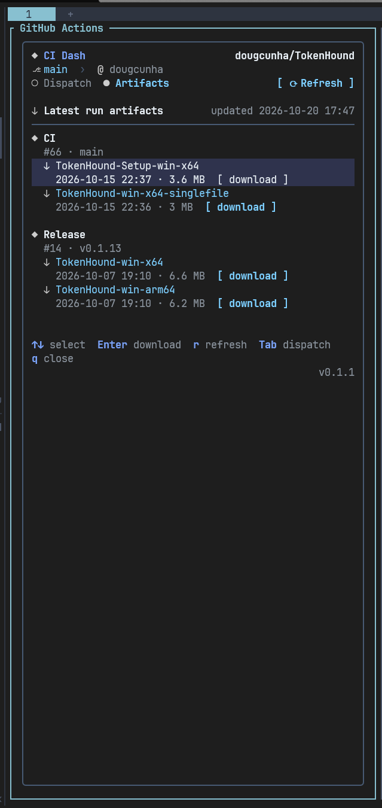
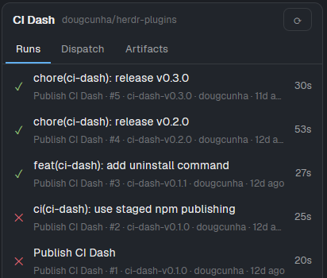
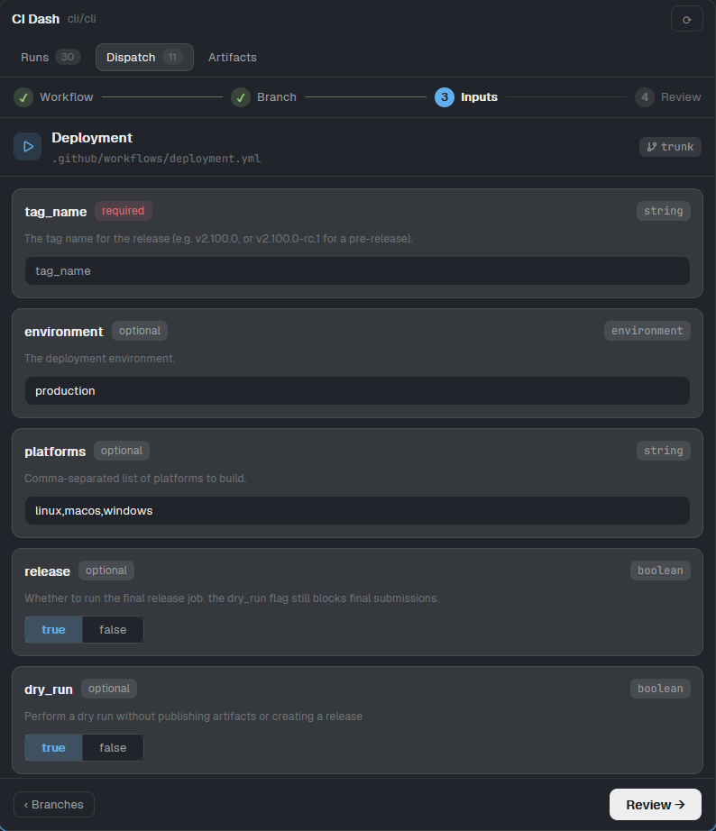

# Herdr Plugins

Small, sharp tools for [Herdr](https://github.com/herdrdev/herdr). They
dispatch GitHub Actions, follow every job and rerun failures without leaving
your terminal.

This repository has two kinds of tools, one for each way to run Herdr:

| You run | You install | Folder |
| ------- | ----------- | ------ |
| The Herdr **TUI** (in a terminal) | a plugin | [`ci-dash`](ci-dash) |
| The Herdr **app** (the desktop window) | a mod or a layout | [`ci-dash-app`](ci-dash-app), [`dock-app`](dock-app), [`image-viewer-app`](image-viewer-app) and [`git-dash-app`](git-dash-app) |

Plugins and mods are different things. A TUI plugin does not run in the app,
and an app mod does not run in the TUI. Both show the same CI Dash idea.

## Quick Start

Copy and paste one prompt to your LLM agent (Claude Code, AmpCode, Cursor, etc.).

For the Herdr TUI:

`Install and configure ci-dash: https://raw.githubusercontent.com/dougcunha/herdr-plugins/refs/heads/main/ci-dash/README.md`

For the Herdr app, the CI Dash mod:

`Read ~/.config/herdr-app/AGENTS.md, then add this mod: https://github.com/dougcunha/herdr-plugins/tree/main/ci-dash-app`

For the Herdr app, the **Dock** layout (a tab bar whose side-panel buttons come from a file, so you add a button without a new clone):

`Read ~/.config/herdr-app/AGENTS.md, then add this layout: https://github.com/dougcunha/herdr-plugins/tree/main/dock-app`

For a **CI** button in the Dock, add the CI Dash mod and then the button:

`Read ~/.config/herdr-app/AGENTS.md, then add this mod: https://github.com/dougcunha/herdr-plugins/tree/main/ci-dash-app and add it to the dock: the "main-dock" layout reads ~/.config/herdr-app/dock/panels.json`

For the Herdr app, the Image Viewer mod (shows an image file, with fit and zoom):

`Read ~/.config/herdr-app/AGENTS.md, then add this mod: https://github.com/dougcunha/herdr-plugins/tree/main/image-viewer-app`

For the Herdr app, the Git Dash mod (pending work of every repository under a base folder, with a **Repos** button in the Dock):

`Read ~/.config/herdr-app/AGENTS.md, then add this mod: https://github.com/dougcunha/herdr-plugins/tree/main/git-dash-app and add it to the dock: the "main-dock" layout reads ~/.config/herdr-app/dock/panels.json`

Optional, to open Markdown files from the Files panel:

`Read ~/.config/herdr-app/AGENTS.md, then add this mod: https://github.com/kissmikijr/herdr-markdown-reader`

`AGENTS.md` is the file that the Herdr app writes in its home folder. It tells
the agent how to add a mod or a layout. The agent reads the folder, tells you
what the mod runs, and copies it into `~/.config/herdr-app/`. It never
overwrites a file that exists.

## Herdr TUI plugins

| Plugin | Description |
| ------ | ----------- |
| [CI Dash](ci-dash/README.md) | GitHub Actions in a Herdr pane: dispatch workflows with ref and inputs, watch live. |



### Install a plugin

The quickest way to install CI Dash is with Bun:

```sh
bunx @dougcunha/ci-dash@latest install
```

The installer copies the plugin to a stable per-user directory, installs its
dependencies, links it with Herdr, and adds the keybindings.

Each plugin also lives in its own directory and can be linked from a checkout.
For CI Dash:

```sh
cd ci-dash
npm ci --omit=dev
herdr plugin link .
```

See the plugin README for requirements, keybindings, and configuration.

To uninstall CI Dash:

```sh
bunx @dougcunha/ci-dash@latest uninstall
```

## Herdr app mods

| Folder | What it is |
| ------ | ---------- |
| [`ci-dash-app`](ci-dash-app/README.md) | The CI Dash mod. It has three tabs: **Runs**, **Dispatch** and **Artifacts**. It opens in a tab or beside a terminal. |
| [`dock-app`](dock-app/README.md) | A layout (`main-dock`) whose tab bar draws its side-panel buttons from `~/.config/herdr-app/dock/panels.json`. Add one entry and a button and its panel show up, with no new clone. It holds one mod, `tabs-dock`. |
| [`image-viewer-app`](image-viewer-app/README.md) | The Image Viewer mod. It shows one image file, fitted to the pane or zoomed from 10% to 800%. |
| [`git-dash-app`](git-dash-app/README.md) | The Git Dash mod. It scans a base folder and lists the Git repositories with pending work (unpushed commits, stash, changes, conflicts). It has a refresh button and a **Repos** button for the Dock. |





### What the app mod does

- **Runs:** the 30 latest runs, grouped by state. A filter box and status chips
  narrow the list. A run shows its jobs and steps live, with **Open**,
  **Cancel** and **Rerun**.
- **Dispatch:** four steps (workflow, branch, inputs, review). Nothing starts
  until you press **Dispatch**.
- **Artifacts:** the artifacts of the latest run, with filters for name, status
  and file type. A click downloads the file to `<repo>/.ci-dash/artifacts/`.

### Install the app mod

The Herdr app must be running, and the
[GitHub CLI](https://cli.github.com/) must be logged in (`gh auth login`).
Copy the mod folder and check it:

```sh
cp -r ci-dash-app/mods/ci-dash ~/.config/herdr-app/mods/ci-dash
herdr-app check ~/.config/herdr-app/mods/ci-dash
herdr-app do tab.new --name "CI" --mod ci-dash
```

On Windows PowerShell, use `Copy-Item -Recurse` and `$env:USERPROFILE`. The
[`ci-dash-app` README](ci-dash-app/README.md) shows the commands.

The mod runs `gh`, `git` and your file manager through the app's `exec`. It
reaches GitHub through your `gh` login and stores no credentials.
[`ci-dash-app/RECIPE.md`](ci-dash-app/RECIPE.md) describes it in full.

### Add a **CI** button with the Dock

Install the CI Dash mod (above) and the [`dock-app`](dock-app/README.md)
layout. Then add one entry to `~/.config/herdr-app/dock/panels.json`:

```json
{ "panels": [ { "id": "ci", "label": "CI", "icon": "mods/ci-dash/ci.svg", "mod": "ci-dash" } ] }
```

The button shows in the tab bar within seconds, and it opens CI Dash as a side
panel next to Files and Changes. `Ctrl+Shift+L` switches layouts.

The `main-dock` layout is a copy of a Herdr 0.1.11 and 0.1.12 file (the two are the same). It does not receive
later Herdr updates. The [`dock-app` README](dock-app/README.md) explains the
limits.

## Topics

This repository is tagged with
[`herdr-plugin`](https://github.com/topics/herdr-plugin) for the TUI plugin,
[`herdr-mod`](https://github.com/topics/herdr-mod) for the app mod and
[`herdr-layout`](https://github.com/topics/herdr-layout) for the app layout.

## License

MIT
