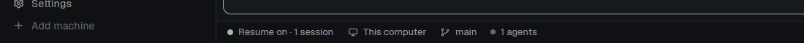
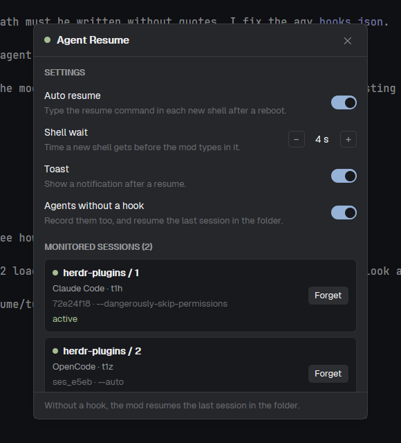

# Agent Resume

A mod for the Herdr app. It starts your coding agent sessions again after a
reboot of the computer (or a restart of herdr-core). It supports
**Claude Code**, **Codex**, **Antigravity** (`agy`) and **OpenCode**, on
Windows, macOS and Linux.

After a reboot, herdr-core keeps your tabs and panes, but each lost terminal
gets an empty shell in its last folder. The agent does not come back. This mod
types the resume command of the agent in each of these shells (for example
`claude --resume <id>`), so every session continues where it stopped.



## What you see

- **The indicator**, at the left of the status bar: a green dot and
  `Resume on · 2 sessions` (the count of terminals with a recorded agent).
  When you turn auto resume off, the dot is gray and the text is
  `Resume off`. The tooltip shows the count of the last resume.
- **The panel**: click the indicator, or run the mod command
  `agent-resume.panel` (bind it in `keys.json`, for example
  `"global": { "ctrl-alt-r": "agent-resume.panel" }`, or run
  `herdr-app do agent-resume.panel`).

  

  - **Auto resume**: on or off. Off stops the automatic resume. The labels
    stay, so you can turn it on again later.
  - **Shell wait**: 1 to 30 s (default 4 s). The time a new shell gets before
    the mod types in it.
  - **Toast**: on or off. The notification after a resume.
  - **Agents without a hook**: on or off (default on). The mod also records
    agents that have no hook, and resumes the last session of their folder.
  - **Monitored sessions**: one card for each recorded terminal: its place,
    the agent, its address, the start of the session id (or `last session`),
    the flags and the state: `active` (the agent runs), `waiting for resume`
    (a new shell), `resume failed` (the command ran, the agent did not
    start), `stopped` (the agent ended in the same shell). **Resume** types
    the resume command now (only into a shell). **Forget** removes the labels.

  The settings are in `shared("agent-resume.config")`, so they stay after a
  restart of the app.
- After a resume, a toast: "Claude Code session resumed" or
  "3 sessions resumed", with the place of each terminal.

## Agents

| Agent | How the mod gets the session | Resume command | Install step |
|---|---|---|---|
| Claude Code | A `SessionStart` / `SessionEnd` hook | `claude <flags> --resume <id>` | Add 2 hooks to `~/.claude/settings.json` |
| Codex | The mod reads `~/.codex/sessions` | `codex resume <id>` | None |
| Antigravity | A `SessionStart` hook | `agy <flags> --conversation <id>` | Add 1 hook to `~/.gemini/config/hooks.json` |
| OpenCode | A TUI plugin | `opencode <flags> --session <id>` | Copy 1 folder and add it to the OpenCode config |
| Any of them, with no hook | The mod sees the agent status | `claude --continue`, `codex resume --last`, `agy --continue`, `opencode --continue` | None (setting "Agents without a hook") |

`<flags>` are the flags that you used to start the agent (for example
`--dangerously-skip-permissions`, `--model opus`, `--auto`). The hook keeps
them, without the session flags and without prompt text. Codex and the mode
without a hook do not know the flags.

## How it works

1. **Record.** A hook or a plugin of the agent writes labels on its
   herdr-core terminal (`HC_TERMINAL_ID`):
   - `resume.agent`: `claude`, `codex`, `agy` or `opencode`
   - `resume.session`: the session id (empty in the mode without a hook)
   - `resume.pid`: the pid of the shell that runs the agent
   - `resume.args`: the flags
   - `resume.tried`: the shell pid of the last resume attempt

   herdr-core keeps the labels of a terminal after a reboot.
2. **Detect a lost terminal.** Every 3 s the mod looks for a live terminal
   that has labels, no agent status and a shell pid that is different from
   `resume.pid`. A different pid means that the shell is new: the old one was
   lost.
3. **Resume.** After the shell wait, the mod writes `resume.tried=<shell pid>`
   and types the resume command. The mark stops a second try in the same
   shell if the resume fails. When the agent runs again, the mod writes the
   new shell pid.
4. **Forget.** The labels go away when:
   - you exit Claude Code with `/exit` (the `SessionEnd` hook);
   - an agent stops its status for 10 s in the same shell (Claude Code and
     Codex clear their status when they exit);
   - another agent starts in the same terminal;
   - you click **Forget**.

**Codex** runs its hooks in a shared background daemon
(`codex app-server --managed-daemon`). The daemon has the environment of the
terminal that started it, so a Codex hook cannot know the terminal of a
session. Instead, the mod reads the first line of each session file
(`~/.codex/sessions/YYYY/MM/DD/rollout-*.jsonl`, today and yesterday). It
gives each Codex terminal the newest interactive session (`codex-tui`) of its
folder that no other terminal has.

### What the mod runs and reads

- It runs `hc get`, `hc label` and `hc send`.
- It reads `~/.codex/sessions` (only the Codex session files).
- The hooks run `hc get` and `hc label`. On Windows, they read the process
  list (`Win32_Process`) to find the command line of the agent. On macOS and
  Linux they use `ps`.
- Nothing uses the network.

## Install

Copy and paste this prompt to your agent:

`Read ~/.config/herdr-app/AGENTS.md, then add this mod: https://github.com/dougcunha/herdr-plugins/tree/main/agent-resume-app and follow its README to install the hook of each agent that I have`

Or do it by hand. In the commands, `<HOME>` is your home folder (for example
`C:\Users\me` or `/home/me`).

### 1. Copy the mod

Copy `mods/agent-resume/` to `~/.config/herdr-app/mods/agent-resume/`. Copy
`mod.json` first: without it, Herdr docks a stray copy. The `hooks/` folder
goes with the mod. Every hook command below points to it.

### 2. Put the mod in your layout

The mod must be in a shown block to run. Herdr's own layouts are read-only:
clone one first (`herdr-app do layout.clone '{"name":"main","as":"my-main"}'`).
Then replace the `status` block of the layout with a row:

```json
{ "id": "status-row", "type": "row", "size": { "px": 28 }, "resizable": false,
  "children": [
    { "id": "agent-resume", "type": "block", "content": { "mod": "agent-resume" }, "size": { "px": 150 } },
    { "id": "status", "type": "block", "content": { "mod": "workspace-status" } } ] }
```

The indicator is at the left of the status bar. On a wide monitor, the right
end is far from the eye.

### 3. Connect each agent that you use

Do only the steps of the agents that are installed (`claude`, `agy`,
`opencode` on the PATH). Keep the hooks and plugins that you have already:
add these beside them. Herdr's own integration files (`herdr-agent-state.*`,
`herdr-tui-session.js`, `herdr-opencode/`) stay as they are.

**Claude Code**: add to `~/.claude/settings.json`, in `hooks`:

Windows:

```json
"SessionStart": [{ "matcher": "^(startup|resume|clear|compact|fork)$", "hooks": [
  { "type": "command", "timeout": 10,
    "command": "powershell -NoProfile -ExecutionPolicy Bypass -File \"<HOME>\\.config\\herdr-app\\mods\\agent-resume\\hooks\\herdr-agent-resume.ps1\" claude start" } ] }],
"SessionEnd": [{ "hooks": [
  { "type": "command", "timeout": 10,
    "command": "powershell -NoProfile -ExecutionPolicy Bypass -File \"<HOME>\\.config\\herdr-app\\mods\\agent-resume\\hooks\\herdr-agent-resume.ps1\" claude end" } ] }]
```

macOS and Linux:

```json
"SessionStart": [{ "matcher": "^(startup|resume|clear|compact|fork)$", "hooks": [
  { "type": "command", "timeout": 10,
    "command": "sh \"$HOME/.config/herdr-app/mods/agent-resume/hooks/herdr-agent-resume.sh\" claude start" } ] }],
"SessionEnd": [{ "hooks": [
  { "type": "command", "timeout": 10,
    "command": "sh \"$HOME/.config/herdr-app/mods/agent-resume/hooks/herdr-agent-resume.sh\" claude end" } ] }]
```

If `SessionStart` is there already, add the new hook to its `hooks` list.

**Antigravity**: add a named hook to `~/.gemini/config/hooks.json` (create the
file if it does not exist). agy splits the command at the spaces and keeps
quotes as text, so **do not quote the path**, and use a path with no spaces.

Windows:

```json
{
  "herdr-agent-resume": {
    "SessionStart": [
      { "type": "command", "timeout": 10,
        "command": "powershell -NoProfile -ExecutionPolicy Bypass -File <HOME>\\.config\\herdr-app\\mods\\agent-resume\\hooks\\herdr-agent-resume.ps1 agy start" }
    ]
  }
}
```

macOS and Linux:

```json
{
  "herdr-agent-resume": {
    "SessionStart": [
      { "type": "command", "timeout": 10,
        "command": "sh <HOME>/.config/herdr-app/mods/agent-resume/hooks/herdr-agent-resume.sh agy start" }
    ]
  }
}
```

agy runs `SessionStart` at the first prompt of a session.

**OpenCode**: the plugin runs in the OpenCode TUI, which sees the terminal.

1. Create the folder `~/.config/opencode/herdr-agent-resume/`.
2. Copy `hooks/opencode-tui.js` into it as `tui.js`.
3. OpenCode 2: add `"./herdr-agent-resume"` to `plugins` in
   `~/.config/opencode/cli.json`:
   `{ "plugins": ["./herdr-opencode", "./herdr-agent-resume"] }`
4. OpenCode 1: add `"./herdr-agent-resume/tui.js"` to `plugin` in
   `~/.config/opencode/tui.jsonc`.
5. Run `opencode plugin list`. The list must show
   `~/.config/opencode/herdr-agent-resume`.

**Codex**: nothing to install. Do not add a hook to `~/.codex/hooks.json`
(see "How it works").

### 4. Check

1. Run `herdr-app check ~/.config/herdr-app/mods/agent-resume`.
2. Start an agent in a Herdr terminal and send one prompt.
3. Open the panel. The agent is in **Monitored sessions** as `active`, with
   the start of its session id.

Agents that already run when you install the mod are recorded without a
session id (`last session`) by the mode without a hook. Start them again to
record the session id.

## Uninstall

1. Remove the hooks from `~/.claude/settings.json` and
   `~/.gemini/config/hooks.json`, and the plugin entry from the OpenCode
   config and the `~/.config/opencode/herdr-agent-resume/` folder.
2. Remove the `agent-resume` block from your layout and the
   `~/.config/herdr-app/mods/agent-resume/` folder.
3. The labels stay on the open terminals until they close. To remove them now:
   `hc label <t> resume.agent= resume.session= resume.pid= resume.args= resume.tried=`.

## Limits

- **agy and OpenCode keep their status after they exit.** herdr-core shows
  the last status until another program reports one. So the mod cannot see
  that you exited them, and the labels stay. After a reboot, the mod resumes
  that session again. Click **Forget** to stop that. (After a reboot the new
  shell has no status, so the resume works.)
- **Codex in the same folder.** With 2 or more Codex terminals in one folder,
  the mod gives the newest session to the agent that started last. A
  `/new` session is followed only when one Codex terminal uses the folder.
- **Codex flags** are not recorded. Put them in `~/.codex/config.toml` (for
  example the sandbox and the approval policy) or in a shell function.
- **The mode without a hook** resumes the last session of the folder. With 2
  agents of the same kind in one folder, both can open the same session.
- **Remote machines.** The Codex session files are read on this computer
  only. The hooks work on any machine where herdr-core runs.
- **Windows paths with spaces** do not work in the agy hook.
- The hooks for macOS and Linux (`herdr-agent-resume.sh`) are not tested on
  those systems yet.
- Sub-agents (terminals that an agent started with `hc run`) are not
  recorded.
