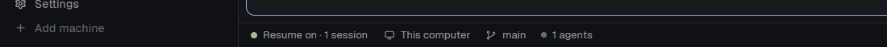

# Agent Resume

A small block at the left of the status bar and a panel. After a reboot (or a
restart of herdr-core), the mod types the resume command of each coding agent
(Claude Code, Codex, Antigravity, OpenCode) in the shell that replaced its
lost terminal, and shows a toast.

## What you see

- In the status bar, at the left, a block of 170 px, 28 px high: background
  `chrome`, top border 1 px `border`, text 11.8 px `muted` (`foreground` on
  hover), items at the left with 14 px left padding (the same as
  `workspace-status`), no right padding and a 6 px gap.
- The block shows a dot of 7 px (`ansi2` when auto resume is on, else `dim`)
  and `Resume on · <n> sessions` or `Resume off`. Its tooltip says if the mod
  is on and how many sessions the last resume started.
- The panel (a popup of 440 × 520 px, background `popover`, text 12.5 px):
  - Header: a dot of 8 px, "Agent Resume" in semibold 13.5 px, a `✕` button.
    Border below.
  - "SETTINGS" (11 px, semibold, `muted`), then 4 rows with a title and a
    hint (11.5 px, `dim`) at the left and a control at the right:
    "Auto resume" (a switch 34 × 18 px: `accent` track with an
    `accent_foreground` knob at the right when on, `input` track with a
    `muted` knob at the left when off), "Shell wait" (`−`, `<n> s`, `+`,
    buttons 22 px with a `border`), "Toast" (a switch) and
    "Agents without a hook" (a switch).
  - "MONITORED SESSIONS (<n>)", then a scroll list of cards (`surface`, 1 px
    `border`, radius 6): a dot and the `where` label in semibold; then
    `<agent name> · <address>` in `muted`; then
    `<8 first characters of the id, or "last session"> · <flags>` in `dim`;
    then the state in its color: `active` (`ansi2`), `waiting for resume`
    (`working`), `resume failed` (`blocked`), `stopped` (`dim`). At the
    right: "Resume" (`solid`, not shown when active) and "Forget" (`raised`).
  - Footer (11.5 px, `dim`, border above): the result of the last button, or
    "Without a hook, the mod resumes the last session in the folder."

## How it behaves

- **Labels** on each herdr-core terminal: `resume.agent` (`claude`, `codex`,
  `agy`, `opencode`), `resume.session` (the id, or empty), `resume.pid` (the
  shell pid), `resume.args` (the flags), `resume.tried` (the shell pid of the
  last attempt).
- **Agents table** (in `resume.js`): name, the `status.app` that the agent
  reports, the resume command with an id and the command without one:

  | id | name | app | resume | last |
  |---|---|---|---|---|
  | claude | Claude Code | claude-code | `claude {args} --resume {id}` | `claude {args} --continue` |
  | codex | Codex | codex | `codex resume {args} {id}` | `codex resume {args} --last` |
  | agy | Antigravity | antigravity | `agy {args} --conversation {id}` | `agy {args} --continue` |
  | opencode | OpenCode | opencode | `opencode {args} --session {id}` | `opencode {args} --continue` |

- **Scan**, every 3 s, for live terminals with a known `resume.agent`:
  - If `agents()` reports a different agent in the terminal: remove the 5
    labels.
  - If it has a status: mark it active. When it becomes active, run
    `hc get` and, if the pid differs from `resume.pid`, write the new pid and
    clear `resume.tried`. Keep the time the agent started (0 on the first
    scan, because the mod cannot know).
  - If it was active and has no status for 10 s: run `hc get`. If the pid is
    still `resume.pid`, the agent exited in that shell: remove the labels.
  - Else, if auto resume is on: run `hc get`. Continue only if the state is
    "waiting" (no status, `resume.tried` is not the pid, pid differs from
    `resume.pid`) and the foreground program is a shell (pwsh, powershell,
    cmd, bash, zsh, fish, sh, dash, nu). After the shell wait (default 4 s,
    counted from the first scan that saw that shell pid), run
    `hc label <t> resume.tried=<pid>` and `hc send <t> "<command>"`.
- **Mode without a hook**: for each agent in `agents()` with a known app, no
  `parent` and no labels: record `resume.agent` and `resume.pid` (no
  session). Codex is recorded at once and always. The others after 10 s, and
  only when "Agents without a hook" is on.
- **Codex**: for each active Codex terminal, read
  `~/.codex/sessions/<today and yesterday as YYYY/MM/DD>/rollout-*.jsonl`
  (`fs.readdir`, then the first line of each new file, cached). Keep the
  files whose `session_meta.payload.originator` is `codex-tui`. Give each
  terminal (newest agent start first) the newest session of its `cwd` that no
  other terminal has. A terminal with no session takes it only if the session
  started after the agent start minus 5 s (or the start is unknown). A
  terminal with a session takes a newer one only if it is the only Codex
  terminal of the folder and the session started after its agent start.
- After one scan with 1 or more resumes, the mod posts one toast:
  "<agent name> session resumed" or "<n> sessions resumed", level success,
  8 s, body = the `where` labels.
- A click on the indicator opens the panel at the pointer. The mod command
  `agent-resume.panel` (from `nextCommand()`) opens it as a dialog.
- The panel runs `hc get` for each recorded terminal every 2 s while it is
  open. A switch or the stepper writes `shared("agent-resume.config")`
  (`{enabled, settleMs, toast, noHook}`), and every copy renders again.
  "Resume" types the resume command now, only into a live shell with no
  status. "Forget" removes the 5 labels.

## Built from

- `mods/agent-resume/`:
  - `mod.json` (`{"place":"none"}`).
  - `main.js`: the indicator and the scanner. One mod, 2 roles: the panel is
    the same mod opened with
    `openOverlay({mod: "agent-resume", kind: "popup", at: "pointer", props: {panel: true}})`.
    The copy reads `props().panel` in `init` and starts no scanner.
  - `panel.js`: the panel. `resume.js`: agents table, config, states, the
    resume command, resume, forget, refresh of the pid, record without a hook.
    `codex.js`: the Codex session files.
  - `hooks/herdr-agent-resume.ps1` (Windows) and
    `hooks/herdr-agent-resume.sh` (macOS, Linux): `<agent> <start|end>` for
    `claude` and `agy`.
  - `hooks/opencode-tui.js`: the OpenCode TUI plugin.
- Layout: a `row` of 28 px that holds an `agent-resume` block of 170 px
  (first, at the left) and the `status` block (`workspace-status`).
- `herdr` functions: `terminals`, `agents`, `hc`, `home`, `notify`, `theme`,
  `props`, `openOverlay`, `closeOverlay`, `nextCommand`, `shared`,
  `setShared`; `fs/promises` (`readdir`, `readFile`).
- **The hook** (`start`):
  1. Exit if there is no `HC_TERMINAL_ID`.
  2. Read stdin as UTF-8 JSON. The session id is `session_id` (Claude) or
     `conversationId` (agy). Only `[A-Za-z0-9_-]`. Exit if `agent_id` is set
     (a sub-agent).
  3. Find the agent process above the hook (Windows: `Win32_Process` parents;
     macOS and Linux: `ps -o ppid=,args=,comm=`), by name (`claude`, `agy`)
     or by the script path of a node install (`/@anthropic-ai/claude-code/`).
  4. Exit for a one-shot run: `-p`/`--print` (Claude), `-p`/`--print`/`--prompt`
     (agy).
  5. Keep the flags: drop the session flags (Claude: `--resume`, `-r`,
     `--continue`, `-c`, `--session-id`, `--fork-session`, `--from-pr`; agy:
     `-c`, `--continue`, `--conversation`) with their value, keep the flags
     that take a value with that value (Claude: `--model`, `--permission-mode`,
     `--effort`, `--agent`, `--settings`, `--add-dir`, `--mcp-config`,
     `--fallback-model`; agy: `--model`, `--mode`, `--effort`, `--agent`,
     `--project`, `--settings`, `--add-dir`, `--log-file`), drop words that are
     not flags and anything with characters outside `[\w.:/\\=-]`.
  6. `hc get $HC_TERMINAL_ID --json` for the pid, then
     `hc label <t> resume.agent=<agent> resume.session=<id> resume.pid=<pid> resume.args=<flags> resume.tried=`.
- **The hook** (`end`, Claude only): only for reason `prompt_input_exit` or
  `logout`, and only when `resume.session` is the same session: remove the 5
  labels.
- **The OpenCode plugin**: a default export `{ id, setup, tui }`. `setup(api)`
  (OpenCode 2) reads `api.ui.router.current()` (`type === "session"`,
  `sessionID`) and the root through `api.data.session.get(id).parentID`.
  `tui(api)` (OpenCode 1) reads `api.route.current` (`name === "session"`,
  `params.sessionID`) and `api.state.session.get`. Every 1 s, when the root
  session changes: `hc get` for the pid, then the labels with
  `resume.agent=opencode` and the flags from `process.argv` (drop `-c`,
  `--continue`, `-s`/`--session <id>`, `--prompt <text>`, the folder; keep
  `--server`, `--log-level`, `-m`/`--model`, `--agent` with their value).

## Install (for every user)

Read the README "Install" section: it has the exact text of each file. In
short:

1. Copy `mods/agent-resume/` (with `hooks/`) to
   `~/.config/herdr-app/mods/agent-resume/`, `mod.json` first.
2. Add the `agent-resume` block to a layout that is not shipped by Herdr
   (clone one first).
3. For each installed agent:
   - Claude Code: `SessionStart` (`claude start`) and `SessionEnd`
     (`claude end`) hooks in `~/.claude/settings.json`. Windows:
     `powershell -NoProfile -ExecutionPolicy Bypass -File "<path>.ps1" claude start`.
     macOS, Linux: `sh "$HOME/.../herdr-agent-resume.sh" claude start`.
   - Antigravity: a named hook in `~/.gemini/config/hooks.json`:
     `{"herdr-agent-resume": {"SessionStart": [{"type": "command", "timeout": 10, "command": "... agy start"}]}}`,
     with the path **not quoted**.
   - OpenCode: `~/.config/opencode/herdr-agent-resume/tui.js` (a copy of
     `opencode-tui.js`), then `"./herdr-agent-resume"` in `plugins` of
     `~/.config/opencode/cli.json` (OpenCode 2) and
     `"./herdr-agent-resume/tui.js"` in `plugin` of
     `~/.config/opencode/tui.jsonc` (OpenCode 1).
   - Codex: nothing.
4. Never edit Herdr's own integration files (`herdr-agent-state.*`,
   `herdr-tui-session.js`, `herdr-opencode/`). Add beside them.
5. Tell the person that the mod runs `hc`, reads `~/.codex/sessions`, and
   that the hooks read the process list.

## Watch out

- The indicator block is 170 px. At 150 px, the text
  `Resume on · 2 sessions` is cut (`2 sessio…`) with zoom 1.1.
- herdr-core keeps the labels and the address of a lost terminal, but gives
  it a new shell. No field says "recovered": the pid change is the signal.
  `reason` stays null on the new shell.
- `hc server restart` does not lose terminals: they live in the holder
  process (`herdr-core hold`). To test a loss, stop the holder process. That
  stops every terminal, the agent that runs the test too.
- **Codex runs hooks in a shared daemon** (`codex app-server
  --managed-daemon`) with the environment of the terminal that started the
  daemon. A Codex hook writes labels on the wrong terminal. Do not use one.
  Codex also writes its session file only at the first prompt.
- **agy splits the hook command at spaces** and keeps quotes as text
  (Windows: it runs `cmd /c "<command>"`). A quoted path fails with "invalid
  characters in the path". agy runs `SessionStart` at the first prompt.
- **OpenCode 2 loads TUI plugins from a folder** listed in `cli.json`
  (`plugins`), with a `tui.js` entry. A file in `tui.jsonc` loads only in
  OpenCode 1. The server plugins (`~/.config/opencode/plugins/`) run in a
  shared background service that does not see the terminal.
- **agy and OpenCode keep their last status after they exit.** The exit
  detection does not work for them. A test that only changes `resume.pid`
  and exits the agent does not resume them, because the status stays.
- `hc send` from an agent terminal wraps the text in `<hc from="...">` tags
  when the target is an agent. The mod runs from the app, without
  `HC_TERMINAL_ID`, so the shell gets plain text. For a test from an agent
  terminal, clear `HC_TERMINAL_ID` first.
- A `claude -p` run inside a Claude terminal also fires `SessionStart` with
  the same `HC_TERMINAL_ID`. Without the one-shot check, it replaces the
  label of the interactive session.
- `agents()` lists only terminals with a pane. A test terminal started with
  `hc run` needs `herdr.space` and `herdr.tab` labels to show up.
- An overlay copy gets its props from `props()`. The first argument of `init`
  is empty for it.
- `herdr-app check` renders only the layout role, and runs no async work. To
  check the panel role, check a temporary copy that always takes the panel
  branch. Run the check with `Start-Process` and a captured exit code: a
  direct call sometimes prints nothing.
- A mod runs only in a shown block. A hidden block never starts.

## Done when

- `herdr-app check ~/.config/herdr-app/mods/agent-resume` passes.
- The status bar shows a green dot and `Resume on · <n> sessions`.
- `herdr-app do agent-resume.panel` opens the panel. Each running agent is
  in the list as `active`.
- Claude Code: `hc get <t> --json` shows `resume.agent=claude`, the session
  id and the flags. `/exit` removes the labels.
- Codex: after the first prompt, the terminal gets
  `resume.session=<id of the newest rollout file of its folder>`.
- Antigravity: after the first prompt, `resume.agent=agy` and
  `resume.session=<conversationId>`.
- OpenCode: `opencode plugin list` shows `herdr-agent-resume`, and after the
  first prompt the terminal has `resume.session=ses_...`.
- A test shell with labels and `resume.pid=1` (and no status) gets the
  resume command in about 7 s.
- After the holder process stops, each recorded agent comes back in its pane.
