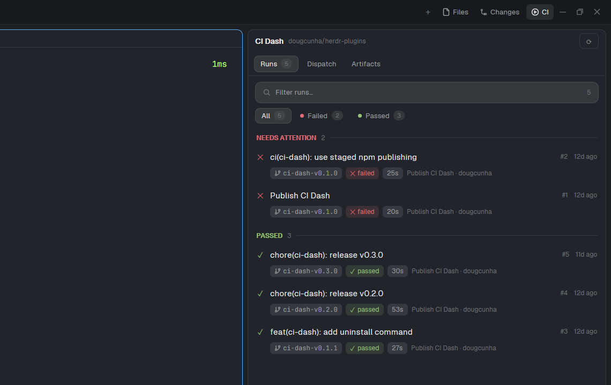

# CI Dash side panel

The Herdr window, with a **CI** button in the tab bar. The button opens CI Dash
as a panel on the right, next to Files and Changes. CI Dash shows the GitHub
Actions runs of the repository you work in. In the Files panel, a click on a
Markdown file opens it in the Markdown Reader, and a click on an image opens it
in the Image Viewer, both beside your terminal.

## What you see

The layout is `main-ci`, a clone of the shipped `main` layout (Herdr 0.1.11).
The window has two columns:

- **Left, 268 px (44 px minimum, 480 px maximum), `chrome` background.** From
  top to bottom:
  `workspace-chrome` (brand, 46 px), the `spaces` and `agents` lists (equal
  weight, 90 px minimum each) and the `workspace-chrome` footer (69 px).
- **Right, the work area.** From top to bottom:
  1. The tab bar, 42 px, mod `tabs-ci`. It is draggable like a title bar.
  2. The body, a row with 8 px padding and 8 px gap: the active tab's panes,
     then the side panel.
  3. The status bar, 28 px, mod `workspace-status`.

The tab bar holds the tabs on the left. On the right it holds the **+** menu,
then three buttons with icons: **Files**, **Changes** and **CI**, then the
window buttons. The button of the open panel has a `selected` background.

The side panel is hidden at first. When open it is 368 px wide (280 px minimum,
900 px maximum, resizable). It shows one of three mods:

- **Files** (`files-md`): the folder tree of the focused terminal. Folders open
  and close. A click on a file that is not Markdown and not an image shows its
  text in the panel, with a **←** button to go back.
- **Changes** (`changes`): the shipped changes panel.
- **CI** (`ci-dash`): a header with `CI Dash` and the `owner/repo` slug, three
  pill tabs (**Runs**, **Dispatch**, **Artifacts**, with counts), then the list
  of the tab. Runs are grouped as *In progress*, *Needs attention*, *Passed* and
  *Other*. Each run has a status icon, a title, a number and age, and pills for
  branch, status, duration and trigger.

Panes are cards: radius 10, 8 px gap, 1 px `border`, an `accent` border when
focused, and a 30 px header (mod `pane`) that always shows. The window has no
system title bar (`titlebar: none`). On macOS the window buttons sit at
`[12, 16]`.

## How it behaves

- **CI, Files and Changes buttons.** A click on a button of a closed panel
  selects that mod and shows the panel. A click on the button of the open panel
  hides it. The CI button is always offered. Files and Changes follow the
  shared value `workspace.panels`, which the welcome screen sets.
- **Per space.** The tab bar remembers for each space which panel was open, or
  that none was, and restores it when you switch spaces. A space that never had
  a choice starts with the panel closed.
- **Agent statuses.** The sidebar, the tab bar and the pane headers are the
  shipped mods of `main`, and they show `working`, `blocked`, `done` and `idle`
  as `main` does: a spinner on a working tab, a dot on a blocked or done tab,
  and the agents list grouped by status.
- **Markdown in Files.** A click on a `.md`, `.markdown`, `.mdown`, `.mkd` or
  `.mdx` file opens the `markdown-reader` mod in a new pane to the right of the
  tab's terminal. The reader opens with its own file tree hidden, so the text
  has the room. The sidebar button in the reader's toolbar shows the tree. A tab
  holds one reader: a click on a second Markdown file closes the first reader
  pane and opens the new one. A tab with no terminal gets the reader as a dialog
  (920 px wide, 85% of the window height).
- **Images in Files.** A click on a `.png`, `.jpg`, `.jpeg`, `.gif`, `.webp`,
  `.bmp`, `.svg`, `.ico`, `.tif` or `.tiff` file opens the `image-viewer` mod the
  same way: a new pane to the right of the tab's terminal, one viewer per tab
  (a second click closes the first viewer pane), and a dialog (920 px wide, 85%
  of the window height) when the tab has no terminal. The Files panel stays
  visible. The viewer fits the image to its pane and has zoom buttons.
- **Files keeps its folder.** While the reader or the viewer has focus, Files still shows the
  folder of a terminal in the same tab. A mod pane has no folder of its own.
- **CI Dash.** It follows the folder of the focused terminal. See its own
  recipe for the Runs, Dispatch and Artifacts tabs.

## Built from

- `layouts/main-ci.json`: a clone of `main` with `"cloned_from": {"name": "main",
  "version": "0.1.11"}`. The node tree is `root` (row) with `sidebar` (column:
  `brand`, `sidebar-lists` with `spaces` and `agents`, `sidebar-footer`) and
  `work` (column: `tabs`, `work-body`, `status`). `work-body` is a row of `main`
  (`{"tab": "active", "pane": {...}}`) and `panel` (a column, 368 px, hidden). In
  `panel`, `panel-body` is a stack with the children `files`
  (`{"mod": "files-md"}`), `changes` (`{"mod": "changes"}`) and `ci`
  (`{"mod": "ci-dash"}`), and `"active": "files"`. The `tabs` block uses
  `{"mod": "tabs-ci"}`.
- `mods/tabs-ci/`: a clone of the shipped `tabs`. It has two changes. The list
  of enabled panels always includes `"ci"`, and it draws one more
  `panelButton("ci", "CI", "mods/ci-dash/ci.svg")`. The window button icons
  (`win-min.svg`, `win-max.svg`, `win-restore.svg`, `win-close.svg`) come from
  its own folder. The panel buttons run `layout.select {stack: "panel-body",
  child}`, `layout.show {id: "panel"}` and `layout.hide {id: "panel"}`.
- `mods/files-md/`: a clone of the shipped `files`, with its asset paths set to
  `mods/files-md/`. It has these changes:
  - `location()` uses a terminal of the same tab when the focused pane is a mod
    pane.
  - A click on a Markdown file runs `readMarkdown(path)`, which calls
    `openBeside("markdown-reader", {file, fileOn, cwd, on, treeVisible: false})`.
  - A click on an image file (`isImage(name)`) runs `viewImage(path)`, which calls
    `openBeside("image-viewer", {file, fileOn})`.
  - `openBeside(mod, props)` picks the terminal pane (the focused one, else the
    first of the tab), closes a pane that shows the same mod in the same tab with
    `pane.close`, and runs `pane.split {pane, direction: "right", mod, props}`.
    With no terminal it calls `openOverlay({mod, props, kind: "dialog", width:
    920, height: 0.85})`.
- `ci-dash`: the CI Dash mod, from the sibling folder `ci-dash-app`. It is not
  inside this folder. Build it from its own `RECIPE.md`.
- `image-viewer`: the Image Viewer mod, from the sibling folder
  `image-viewer-app`. It takes the props `file` and `fileOn`. Build it from its
  own `RECIPE.md`.
- `markdown-reader`: a mod by another author
  (https://github.com/kissmikijr/herdr-markdown-reader). It is not part of this
  folder and has no license, so this folder does not include it. It takes the
  props `file`, `fileOn`, `cwd`, `on` and `treeVisible`.
- Shipped mods that the layout uses: `workspace-chrome`, `spaces`, `agents`,
  `pane`, `changes`, `workspace-status`, and `menu` and `new-menu` (opened by the
  tab bar).
- `install.mjs`: a Node script. It copies every mod of `mods/`, of
  `../ci-dash-app/mods/` and of `../image-viewer-app/mods/` into `~/.config/herdr-app/mods/`, copies the layout
  when it is absent, and runs `herdr-app check` on each mod.
- Programs that the mods run through `exec`: `gh` and `git` (`ci-dash`), `git`,
  `powershell` on Windows and `sh` elsewhere (`files-md`), the file manager
  (`ci-dash`), and `powershell` on Windows or `sh`, `rm` and `find` elsewhere
  (`image-viewer`). `ci-dash` reaches GitHub through the `gh` login.

## Watch out

- **Disclose this before installing.** `ci-dash` uses the network through `gh`.
  `files-md`, `ci-dash` and `image-viewer` run programs with `exec`. `files-md`
  reads files outside its own folder: the folders and files that you open.
  `image-viewer` reads the images that you open and writes a temporary copy
  under `data/image-viewer/` in the Herdr home.
- **The clones never update.** `main-ci` and `tabs-ci` are copies of Herdr
  0.1.11 files, and `files-md` is a copy of `files`. When Herdr ships a new
  `main`, `tabs` or `files`, you must clone again and redo the small changes
  above.
- **The layout needs `ci-dash`.** The `ci` block points to the `ci-dash` mod.
  Add that mod first, or the CI panel stays empty.
- **The reader is optional but needed for Markdown.** Without the
  `markdown-reader` mod, `pane.split` fails with `no mod "markdown-reader" in
  mods/`, so a click on a `.md` file opens nothing. Everything else still works.
- **The viewer is needed for images.** Without the `image-viewer` mod,
  `pane.split` fails and a click on an image opens nothing. Add the mod first.
- **The hidden panel is a layout state.** The layout file says `hidden: true`.
  Herdr saves a click in `layouts/.state/`, and the tab bar saves the choice per
  space. Do not edit those files.
- **An existing layout is never overwritten.** Without `--force`, the installer
  keeps your `main-ci.json`. With `--force` it keeps the old file as
  `main-ci.json.bak-<time>`.
- **Limits.** `exec` allows 30 seconds per call. Files lists 500 entries per
  folder and 5,000 in total. Herdr reads files of up to 1 MiB for the reader.
- **Not tested:** other machines (`on`) and macOS and Linux.

## Done when

- `herdr-app check` passes for `tabs-ci`, `files-md` and `ci-dash`.
- `herdr-app do layout.switch '{"name":"main-ci"}'` shows the layout, and
  `layout.error` does not exist.
- The tab bar shows **Files**, **Changes** and **CI** on the right, and the side
  panel is closed.
- A click on **CI** opens a 368 px panel with CI Dash, and the button has a
  `selected` background. A second click hides the panel.
- In a space with a repository, the Runs tab lists runs with status, branch and
  duration pills.
- You open the panel in space A, switch to space B, then back to A. The panel
  is open again in A.
- A click on a `.md` file in Files opens the reader to the right of the
  terminal, with no file tree in the reader. A click on another `.md` file
  leaves one reader pane in the tab.
- A click on an image file in Files opens the viewer to the right of the
  terminal, and the Files panel stays visible. A click on another image leaves
  one viewer pane in the tab.
- A click on a file that is not Markdown and not an image shows its text in the
  Files panel, and no reader or viewer opens.
- With the reader or the viewer in focus, Files still shows the terminal's folder.
- `node install.mjs --dir <empty folder>` copies four mods and the layout,
  and each `herdr-app check` passes.
