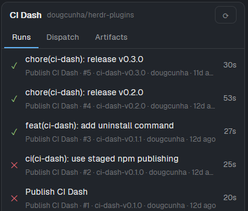
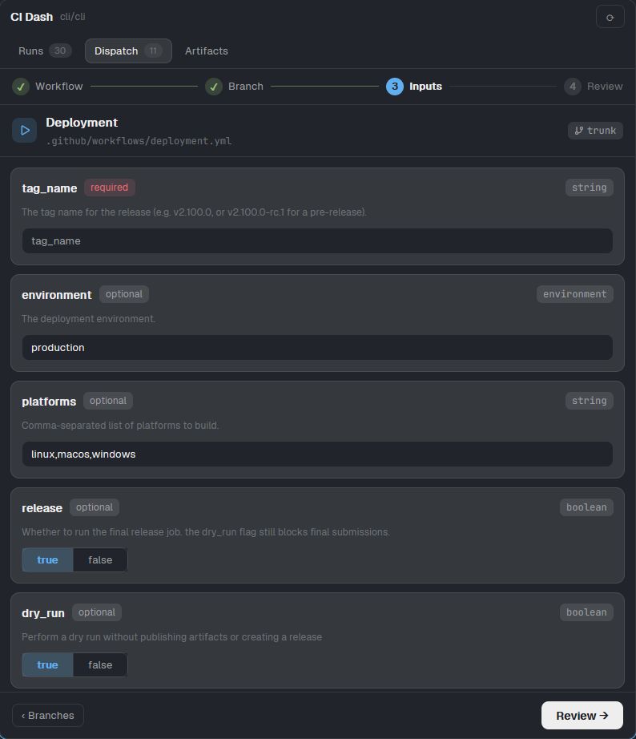

# CI Dash for the Herdr app



A mod for the **Herdr app** (the desktop window, not the TUI) that shows the
GitHub Actions runs of the repository you are working in, starts workflows with
`workflow_dispatch`, and downloads build artifacts. It is a port of the
[`ci-dash`](../ci-dash) TUI plugin and has three tabs: **Runs**, **Dispatch**
and **Artifacts**. [`RECIPE.md`](RECIPE.md) describes it in full.

## Requirements

- The Herdr app (tested on 0.1.11).
- The [GitHub CLI](https://cli.github.com/) logged in with `gh auth login`. The
  token needs `repo` scope for private repositories and permission for Actions.

The mod runs `gh`, `git` and your file manager through the app's `exec`, and
reaches GitHub through your `gh` login. It stores no credentials and reads no
files of its own.

## Install

Copy the mod folder into the Herdr home, then check it:

```sh
cp -r mods/ci-dash ~/.config/herdr-app/mods/ci-dash
herdr-app check ~/.config/herdr-app/mods/ci-dash
```

On Windows PowerShell:

```powershell
Copy-Item -Recurse mods\ci-dash "$env:USERPROFILE\.config\herdr-app\mods\ci-dash"
herdr-app check "$env:USERPROFILE\.config\herdr-app\mods\ci-dash"
```

Open it in a tab or beside your terminal:

```sh
herdr-app do tab.new --name "CI" --mod ci-dash
herdr-app do pane.split --direction right --mod ci-dash
```

To bind a key, add `"ctrl-shift-g": "mod.open:ci-dash"` to the `global`
section of `~/.config/herdr-app/keys.json`.

For a **CI** button in the tab bar that opens it as a side panel next to Files
and Changes, use [`ci-dash-app-panel`](../ci-dash-app-panel).

## Use

- **Runs**: the 30 latest runs, grouped as *In progress*, *Needs attention*,
  *Passed* and *Other*. Each run shows pills for its branch, status, duration
  and trigger. A **filter box** at the top matches title, workflow, branch,
  actor, trigger and `#number`, and **chips** (`All`, `Running`, `Failed`,
  `Passed`, `Other`, with counts) narrow by status. Click a run for its jobs and
  steps, live status, **Open** (browser), **Cancel**, and **Rerun**. Open runs
  poll every 5 s, backing off to 30 s. A notification fires when a run you were
  watching finishes.
- **Dispatch**: four steps, like the TUI plugin, shown in a step indicator you
  can click to go back.

  

  1. **Workflow**: a card for each active workflow that declares
     `workflow_dispatch` on the default branch, with its number of inputs and
     the status of its latest run. A filter box narrows the list. The list loads
     the first time the tab opens, one file read per workflow.
  2. **Branch**: the default and the current branch come first. Tags are not
     listed.
  3. **Inputs**: a card for every input of `on.workflow_dispatch.inputs`, marked
     `required` or `optional`, with its type and description. `string`,
     `number` and `environment` are text boxes, `boolean` is a `true | false`
     control, and `choice` is a row of options. Numbers and required fields are
     checked before dispatch. A workflow with no inputs skips this step.
  4. **Review**: the workflow, the branch and every value. Nothing starts until
     you press **Dispatch**. The mod then finds the new run and opens it in the
     Runs tab.
- **Artifacts**: the artifacts of the latest run that produced any, per
  workflow, with a filter box (name, workflow, branch), status chips
  (`Available`, `Downloaded`, `Expired`) and, when the names allow it, a **Type**
  row with a chip for each file type found (`.zip`, `.exe`, `.7z`, `.tar.gz`…)
  and its count. GitHub's list has only names and sizes, so the type is the
  known extension at the end of the name; anything else is `other`. Click a row
  to download it to
  `<repo>/.ci-dash/artifacts/<run-id>/<name>`. `↗` opens that folder.
- The repository follows the focused terminal's folder, falling back to the
  other terminals of the space, then to the last repository found.

Props of the block (or of `tab.new --props`) are read once when the mod starts:

| Prop | Effect |
| --- | --- |
| `tab` | First tab: `runs` (default), `dispatch` or `artifacts`. |
| `repo` | Pin a repository, `owner/repo` or `host/owner/repo`. |
| `workflow` | Dispatch tab: pre-select the first workflow whose name or path contains this text. |
| `ref` | Dispatch tab: with `workflow`, also pre-select this branch. It stops at the inputs or the Review step and never dispatches. |
| `filter` | Text to put in the Runs and Artifacts filter boxes. |
| `status` | Chip to select: `live`, `attention`, `passed` or `other` (runs); `available`, `downloaded` or `expired` (artifacts). |
| `type` | Artifacts file type to select, such as `zip` or `exe`. |

Example, read only: `herdr-app do tab.new --mod ci-dash --props '{"tab":"dispatch","workflow":"publish","ref":"main"}'`.

## Known limits

- `exec` allows 30 s per call, so a download of a very large artifact can
  time out. A follow-up can move downloads to `hc run`.
- Mouse only: no keyboard navigation yet. Text boxes take keyboard input.
- Dispatch lists branches only, not tags, and `environment` inputs are plain
  text, not a picker.
- Finding the new run can take up to about 90 s when GitHub does not return its
  id. If it is not found, the Dispatch tab says so and does not dispatch twice.

## Third-party code

`mods/ci-dash/yaml.js` is a minified browser bundle of
[`yaml`](https://github.com/eemeli/yaml) 2.8.1 (ISC license, see
`mods/ci-dash/yaml.LICENSE`), used to read workflow files. Rebuild it with:

```sh
npm install yaml@2.8.1 esbuild --ignore-scripts
echo 'export { parse } from "yaml";' > entry.js
npx esbuild entry.js --bundle --format=esm --platform=browser --target=es2020 --minify --legal-comments=inline --outfile=yaml.js
```
