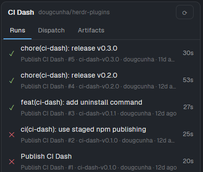

# CI Dash

A panel for the Herdr app that shows the GitHub Actions runs of the repository you are working in, starts workflows with `workflow_dispatch`, and downloads build artifacts. It has three tabs: **Runs**, **Dispatch** and **Artifacts**. It follows the folder of the focused terminal, so it always shows the repository you are in. All GitHub access goes through the `gh` CLI; the mod stores no credentials.

## What you see

One rounded card (radius 10, 1 px `border`, `background` fill, 13 px text) with three stacked bands:

1. **Header, 38 px.** `CI Dash` in semibold, then the repository slug (`owner/repo`, 11 px, `dim`, truncated), then a **⟳** button on the right. On the Artifacts tab a **↗** button sits left of it.
2. **Tab strip, 32 px, 1 px bottom border.** Three text tabs: `Runs`, `Dispatch`, `Artifacts` (12 px, 12 px side padding). The active tab is `foreground` with a 2 px `accent` underline; the others are `muted` with an underline in the `background` color.
3. **Body**, one of:
   - **Runs list.** Rows 50 px tall: a 14 px status icon, the run title on one line, and below it, 11 px `dim`: `<workflow> · #<run number> · <branch> · <actor> · <time ago>`. The run duration is on the right (11 px, `muted`). Rows highlight with `hover` under the pointer.
   - **Run detail.** A bar with `‹ Runs`, `Open`, and `Cancel` (while running) or `Rerun` (when finished). Under it: the run title with its icon, a `<workflow> #<n> · <branch> · <event> · <actor>` line, and a colored `<status> · <duration>` line. Then each job (28 px, semibold: icon, name, duration) with its steps (22 px, indented 30 px: icon, name, duration). When the run has finished and produced artifacts, an `ARTIFACTS` caption (11 px, semibold, `muted`) and one row per artifact.
   - **Dispatch**, four screens: a filter box above a list of workflows (name, then path in 11 px `dim`); a branch list with the filter box; the inputs form; and a Review screen.
   - **Artifacts list.** Groups headed by `<WORKFLOW> · #<n> · <branch>` (11 px, semibold, `muted`). Rows are 46 px: the artifact name, then `<size> · <time ago>`, and an action word on the right.
   - Loading, empty and error messages: a title line and, when there is one, a 12 px `dim` hint.
4. **Note line.** A one-line 11 px `blocked`-colored message at the bottom with a 1 px top border, only while there is something to say (a download result, a cancel request, an error).

Buttons are 26 px tall, 10 px side padding, radius 7, 1 px border, 12 px text. A primary or active button uses `accent` for border and text; a disabled one uses `dim`.

## How it behaves

**Status icons** (14 px): `✓` success in `ansi2`, `✕` failure, timed out or startup failure in `ansi1`, `!` action required in `ansi3`, `–` cancelled, skipped, neutral or stale in `dim`, `○` queued in `blocked`, and a spinning ring (`spinner.svg`, 900 ms per turn, `working` color) while in progress. Jobs and steps use the same icons.

**Which repository.** The folder comes from the focused terminal, else any terminal in the same tab, else any terminal in the same space, else the last folder found. `gh repo view --json nameWithOwner,url,isPrivate,defaultBranchRef` run in that folder names the repository. A pane outside a repository keeps showing the repository already loaded. The prop `repo` pins one.

**Runs tab.** Loads the 30 latest runs on start. While any listed run is not finished, the list refreshes every 5 s without a loading state. A run that goes from running to finished posts a notification: title `CI <result>: <workflow>`, body `#<n> · <branch> · <duration>`, level `success`, `error` or `info`.

**Run detail.** Click a run. It polls the run and its jobs every 5 s for 12 polls, then every 10 s until poll 60, then every 30 s, and stops when the run finishes. `Open` opens the run in the browser. `Cancel` and `Rerun` act at once. After a rerun the panel ignores a still-old answer for 20 s so the run does not flash back to finished. `‹ Runs` or the Runs tab goes back.

**Dispatch tab.** Loads on first use. Four steps:
1. *Workflow.* Active workflows whose file declares `workflow_dispatch` on the default branch. The filter matches name and path.
2. *Branch.* Branches only. The default branch (tag `default`) and the branch of the focused terminal (tag `current`) come first.
3. *Inputs.* One card per input under `on.workflow_dispatch.inputs`: name, a red `*` when required, the type in 10 px `dim`, the description, and an editor. `string`, `number` and `environment` use a 30 px text box. `boolean` uses two chips, `true` and `false`. `choice` uses one chip per option, wrapping. The default value is pre-filled. A workflow with no inputs skips to Review. `Review` checks required fields, numbers and choices and shows the first problem in red.
4. *Review.* Lists workflow, branch and every value (`(empty)` when blank). The text `Nothing starts until you press Dispatch.` is shown. `Dispatch` sends the request, finds the new run, and opens it in the Runs tab. If GitHub returns no run id, the panel looks for the run on each 5 s tick for up to 18 tries, and then says it could not find it. It never dispatches twice.

**Artifacts tab.** Loads on first use and on `⟳`. For every workflow it takes the latest 5 runs and shows the artifacts of the first run that has any. Groups are sorted by newest artifact. Clicking a row downloads it to `<repository root>/.ci-dash/artifacts/<run id>/<artifact name>` (the name is made safe for file systems). The row shows `Downloading…`, then `✓ Downloaded` and the path, or `Retry` and the error. Expired artifacts show `expired` and do nothing. `↗` opens the last download folder, else `.ci-dash/artifacts`, in the file manager, and says so in the note line when nothing was downloaded yet.

**Props** (read once when the mod starts): `tab` = `runs` | `dispatch` | `artifacts`; `repo` = `owner/repo`; `workflow` = text that pre-selects the first matching workflow; `ref` = with `workflow`, also pre-selects that branch. These stop at the inputs or Review step and never dispatch.

## Built from

Files in `mods/ci-dash/`: `main.js` (the `View`, header, Runs, detail, Artifacts), `dispatch.js` (the Dispatch tab), `gh.js` (every `gh` call), `workflow-inputs.js` (reads `on.workflow_dispatch.inputs`), `format.js` (time, size, status and `mapLimit` helpers), `yaml.js` (a minified browser bundle of `yaml` 2.8.1, ISC license in `yaml.LICENSE`), `spinner.svg`, `ci.svg`, and `mod.json` = `{ "place": "none" }`.

Imports: `View`, `div`, `svg` from `gpui-kit`; `v_flex`, `h_flex`, `InputState`, `Input` from `gpui-base`; `spaces`, `panes`, `focused`, `exec`, `home`, `theme`, `notify`, `props` from `herdr`. Theme colors used by name: `background`, `border`, `foreground`, `muted`, `dim`, `accent`, `hover`, `selected`, `blocked`, `working`, `ansi1`, `ansi2`, `ansi3`. Timers: one `cx.timer.every(5000)`; the spinner uses `.spin(900)`.

Programs it runs with `exec` (tell the person before installing):
- `gh repo view`, `gh api` (workflows, runs, jobs, artifacts, branches, file contents, cancel, rerun, dispatch), `gh run view --web`, `gh run download`. These use the network and the person's `gh` login.
- `git rev-parse --show-toplevel`, to find the repository root.
- `explorer.exe`, `open` or `xdg-open`, and `pwsh -Command Test-Path` or `test -d`, to open and check the download folder.

It reads no files itself and writes only the downloaded artifacts under `.ci-dash/artifacts/` in the repository.

The dispatch call is `gh api --method POST repos/<owner>/<repo>/actions/workflows/<id>/dispatches -f ref=<branch> -f inputs[<name>]=<value> … -F return_run_details=true`. Inputs use `-f` so every value stays a string.

## Watch out

- `exec` has a 30 s limit, no stdin and no `Buffer`. So the dispatch body goes as `-f` flags, workflow files are read with `Accept: application/vnd.github.raw+json` instead of base64, and a very large artifact can time out.
- `gh api --slurp` cannot be combined with `--jq`. The mod parses the JSON itself.
- A mod pane has no folder of its own, and `spaces()[i].tabs[]` has no `terminals` field. Use `panes()` (matched by `tab`) to find the folder of a terminal.
- `props()` inside a callback can answer for another copy of the mod. Read props once in `init` and keep them.
- Create `InputState` objects when the form is built, never inside `render()`, or the text resets on every redraw.
- Never test Dispatch against a workflow that publishes or deploys. Use the `workflow` and `ref` props to reach the form, or a public repository such as `cli/cli` with `workflow` = `deployment` for a read-only form with real inputs.
- Workflow, job, artifact and branch lists are read in full (100 per page, all pages). The Runs tab shows only the 30 latest runs, and the Artifacts tab looks only at the 5 latest runs of each workflow, so an older artifact is not listed.
- Needs `gh` installed and logged in (`gh auth status`). The token needs `repo` scope for private repositories and permission for Actions.
- Mouse only; text boxes take keyboard input. Tags are not listed as refs.
- `mod.json` has `"place": "none"`, so the mod appears only where a layout or a command puts it: `herdr-app do tab.new --mod ci-dash`, or `pane.split` with `mod`.

## Done when

- `herdr-app check mods/ci-dash` passes and `herdr-app status` lists no errors after the mod opens.
- In a repository with a GitHub remote, the Runs tab lists the latest runs with status icons, and a run that is in progress shows the spinner.
- Clicking a run shows its jobs and steps, and `Open` opens it in the browser.
- The Dispatch tab lists only workflows that declare `workflow_dispatch`, and a workflow with inputs shows one editor per input with the right control for each type.
- Review shows the values and sends nothing until `Dispatch` is pressed. If the dispatch call fails, Review shows the error and nothing starts.
- The Artifacts tab lists artifacts per workflow, and a click on a row writes the files to `.ci-dash/artifacts/<run id>/<name>`.
- Focusing a terminal in another repository switches the panel to that repository; focusing a terminal outside any repository keeps the current one.
