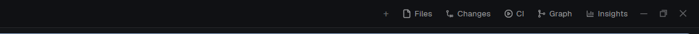

# Dock

A Herdr app layout whose tab bar builds its side-panel buttons from a file.

Herdr's own `main` layout is read-only, and its tab bar has a fixed list of
buttons (Files, Changes). To add one more button you had to clone the tab bar
and the layout, and edit both. With Dock you clone nothing more: you add one
line to `~/.config/herdr-app/dock/panels.json`, and the button and its panel
show up while the app runs.



## Quick Start

Copy and paste this prompt to your LLM agent:

`Read ~/.config/herdr-app/AGENTS.md, then add this layout: https://github.com/dougcunha/herdr-plugins/tree/main/dock-app`

To add a button later, for example the [Git Graph](https://github.com/rabeeh-ta/herdr-git-graph) mod:

`Read ~/.config/herdr-app/AGENTS.md, then add this mod: https://github.com/rabeeh-ta/herdr-git-graph and add it to the dock: the "main-dock" layout reads ~/.config/herdr-app/dock/panels.json`

## What it adds

| Part | What it is |
| ---- | ---------- |
| `layouts/main-dock.json` | Herdr's `main` layout (the same in 0.1.11 and 0.1.12) with the tab bar `tabs-dock`. Side panel: Files and Changes. |
| `mods/tabs-dock/` | Herdr's tab bar plus the dock: it reads `dock/panels.json`, draws the buttons and adds the panels to the layout. |

Switch to the layout with `ctrl-shift-l`. Your own layout stays as it was.

## `panels.json`

```json
{
  "panels": [
    { "id": "graph", "label": "Graph", "icon": "mods/git-graph/icons/graph.svg", "mod": "git-graph" },
    { "id": "insights", "label": "Insights", "icon": "mods/insights/insights.svg", "mod": "insights", "opens": "tab", "name": "Insights" }
  ]
}
```

| Field | Meaning |
| ----- | ------- |
| `id` | `a-z`, `0-9`, `-`, up to 32 characters, unique. |
| `label` | The button text. |
| `icon` | A path in the Herdr home: `.svg` (drawn in the text color) or a picture. |
| `mod` | The folder in `mods/` to show. It must exist. |
| `props` | Optional. Given to the mod as its `props()`. |
| `opens` | `"panel"` (default): a block in the side panel. `"tab"`: a tab per space with the mod as its only pane. `"command"`: a button that runs a Herdr command (no `mod`). |
| `name` | For `"tab"`: the tab name. |
| `run`, `args` | For `"command"`: the command and its arguments, for example `"run": "layout.switch", "args": { "name": "kanban" }`. |

A `layout.switch` button saves the shown layout in `shared("layout.previous")` first. The [Kanban](../kanban-app) layout reads it, so its button goes back to the layout you came from.

- A save of the file shows in the bar at once. Remove an entry and its button and panel go.
- A broken file keeps the last good list and shows an error toast. A bad entry is skipped.
- Bind a key to a panel in `keys.json`: `"layout:main-dock": { "ctrl-alt-shift-g": "tabs-dock.graph" }`.

## What it does on your machine

- It reads `dock/panels.json` and the folder list of `mods/` in the Herdr home.
- It edits `layouts/main-dock.json` with the `layout.set` command, to add or remove panel blocks.
- It runs no program and uses no network.

## Limits

- It works only on a personal layout, so it comes with its own copy of `main`.
  That copy does not follow Herdr updates. When Herdr changes the tab bar,
  clone `main` and `tabs` again.
- Built and tested on Windows with Herdr 0.1.11. Herdr 0.1.12 did not change the `main` layout or the `tabs` mod, and the dock loads there without errors. Untested: macOS, Linux, remote machines.
- `RECIPE.md` has the full brief to build it from scratch.
