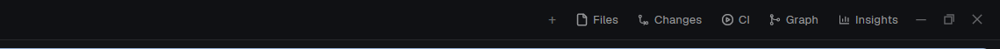

# Dock

A Herdr layout (`main-dock`) whose tab bar draws its side-panel buttons from a file, `~/.config/herdr-app/dock/panels.json`. Add one entry to the file and a new button shows in the bar, with its panel. You do not clone the tab bar or edit the layout again. Remove the entry and the button and its panel go away.



## What you see

The window of Herdr's `main` layout, with the same sidebar, tabs as pills and pane cards. Only the tab bar differs. Its right end, left to right:

- `+` (26px): the new-tab menu (`new-menu` popup, 250 x 512).
- **Files** and **Changes**: always first, when their blocks are in the layout and the welcome screen chose them (`shared("workspace.panels")`). Icons `mods/files/file.svg` and `mods/changes/changes.svg`.
- One button for each valid entry of `panels.json`, in the file's order: 26px tall, 14px icon, 12px label, `muted` text on `chrome`; `selected` background while its panel is open; `hover` background under the pointer.
- On Windows and Linux the minimize, maximize and close buttons (26px).

The side panel is 368px wide (min 280, max 900), hidden at first, on the right of the work area, with a stack `panel-body`. The stack holds `files`, `changes` and one block for each panel entry.

## How it behaves

- A click on a panel button opens the panel on that child (`layout.select` then `layout.show`). A click on the button of the open panel hides it. A click on another button switches the child.
- The open panel is remembered for each space (`localStorage` key `panels` of the tab bar): switching space restores that space's panel, or hides it if the space never had one. While the bar adds blocks, a saved choice such as `graph` is not lost: it waits up to 3 s.
- **Entry kinds.** `"opens": "panel"` (default) adds a block to `panel-body`. `"opens": "tab"` makes the button focus the space's tab that shows `mod` as its only pane, or make that tab with `tab.new {name, mod}`. It adds no block.
- **The file is live.** The bar watches `dock/` (`watchFolder`). Each save reloads the list. A missing file is an empty list. A file with broken JSON, or without a `panels` array, keeps the last good list and posts an error toast (`Dock: panels.json`). A bad entry (a wrong id, a missing label or icon, a `mod` that is not in `mods/`, a repeated id) is skipped, and the toast names the first one. The other entries still work.
- **Adding blocks.** A panel entry whose block is missing is added to the layout with one `layout.set` of the whole tree, read from `layout()` and written back with the new child. The same call removes the blocks that this bar added before and the file no longer lists. The bar remembers the ones it added in `localStorage` key `injected`.
- **One try.** The bar tries once for each pair of layout name and file version. A layout that refuses the edit (a shipped layout, such as Herdr's own `main`) is not tried again until the file changes.
- An entry whose `id` is the id of another node of the layout (`main`, `status`, `agents`, ...) is ignored.
- Keys: a command `tabs-dock.<id>` toggles that panel as its button does (`nextCommand`). Bind it in `keys.json`, for example `"layout:main-dock": { "ctrl-alt-shift-g": "tabs-dock.graph" }`. Ask before taking a key that the person already uses.
- Agent statuses show on the tab pills as in Herdr's tab bar: a spinner (`working`), a dot in `blocked` or `done` color. `idle` shows nothing.

### `panels.json`

```json
{
  "panels": [
    { "id": "graph", "label": "Graph", "icon": "mods/git-graph/icons/graph.svg", "mod": "git-graph" },
    { "id": "ci", "label": "CI", "icon": "mods/ci-dash/ci.svg", "mod": "ci-dash", "props": { "repo": "owner/name" } },
    { "id": "insights", "label": "Insights", "icon": "mods/insights/insights.svg", "mod": "insights", "opens": "tab", "name": "Insights" }
  ]
}
```

| Field | Meaning |
| ----- | ------- |
| `id` | `a-z`, `0-9`, `-`, 1 to 32 characters, unique. It is the stack child id and the key command name. |
| `label` | The button text. |
| `icon` | A `.svg` (drawn in the text color) or a picture, a path in the Herdr home. |
| `mod` | The folder in `mods/` that the panel (or the tab) shows. It must exist. |
| `props` | Optional. Passed to the mod as its `props()`. |
| `opens` | `"panel"` (default) or `"tab"`. |
| `name` | For `"tab"`: the tab name. Default: `label`. |

## Built from

- `layouts/main-dock.json`: Herdr 0.1.11's `main` layout (a row: `sidebar` with `brand`, `spaces`, `agents`, `sidebar-footer`; `work` column with `tabs` 42px, `work-body`, `status` 28px), with `tabs` set to the mod `tabs-dock`, and `panel-body` holding only `files` (mod `files`) and `changes` (mod `changes`). Ids `panel`, `panel-body`, `files` and `changes` must stay: the bar and other mods look them up.
- `mods/tabs-dock/`, `mod.json` `{ "place": "none", "title": "Dock tabs" }`. `main.js` is Herdr's `tabs` mod (tab pills, drag to reorder, rename, close, window buttons, per-space panel memory) with the dock added.
- `herdr` functions: `layout()`, `shared()`, `spaces()`, `panes()`, `appHome()`, `readTextFile`, `watchFolder`, `nextCommand`, `notify`, `openOverlay`, `run`. Commands: `layout.set`, `layout.select`, `layout.show`, `layout.hide`, `tab.new`, `tab.select`, `tab.move`, `tab.rename`, `tab.close`, `tab.next`, `tab.prev`, `pane.focus`, `pane.zoom`, `window.*`. `fs/promises`: `mkdir`, `readdir`.
- Shipped mods it uses: `workspace-chrome`, `spaces`, `agents`, `pane`, `workspace-status`, `files`, `changes`, `new-menu`, `menu`.
- Art: `win-min.svg`, `win-max.svg`, `win-restore.svg`, `win-close.svg` in `mods/tabs-dock/` (vector window icons).
- It reads `mods/` (a folder list) and `dock/panels.json` in the Herdr home. It runs no program and uses no network.

## Watch out

- **`layout.set` only works on personal layouts.** Herdr's own `main` refuses it, so this is a layout of its own. Clone it again from the shipped `main` when Herdr changes the tab bar: this copy is frozen at 0.1.11.
- `layout.set` replaces the whole tree. Read `layout()` and change only `panel-body`, or you lose the person's other edits. A block does not keep unknown fields (a `"dock": true` marker was dropped), so the bar keeps its own list of the blocks it added.
- Never call `layout.set` from `render()` without a guard: it re-renders. The bar keeps a key of layout name plus file version and tries once for each key.
- `watchFolder` needs a folder that exists. The bar makes `dock/` with `mkdir` before it watches. Watch `dock/`, not the Herdr home: the home changes all the time.
- Keep `panels.json` outside `mods/`: a reinstall of the mod replaces its folder.
- Write `mod.json` before `main.js` in a new mod folder, or Herdr docks a copy of the mod into the shown layout.
- Blocks removed from the file are removed from the layout only if this bar added them. A block you wrote by hand in `panel-body` stays.
- A panel entry needs its mod to be a panel (it fills a block). A mod made for panes only may look wrong in 368px.
- Untested: macOS, Linux, a remote machine's window.

## Done when

- `herdr-app check ~/.config/herdr-app/mods/tabs-dock` passes, and `herdr-app status` shows `"layout": "main-dock"` and `"errors": []`.
- With no `panels.json`, the bar shows Files and Changes only, and both open their panels.
- Add `{ "id": "graph", ... }` to `panels.json` while the app runs: within 5 s a Graph button shows, `layouts/main-dock.json` has a `graph` child in `panel-body`, and a click on the button opens the panel.
- Remove that entry: the button goes and the `graph` child leaves the file. A block that you added by hand stays.
- Save `{ "panels": [ ` (broken): an error toast shows, and the buttons stay as they were.
- An entry with `"mod": "does-not-exist"`, or with `"id": "main"`, is skipped, and the other entries work.
- An entry with `"opens": "tab"` focuses its tab on the second click, and does not make a second tab.
- Open Graph in space A and close the panel in space B: switching between the spaces restores each choice.
