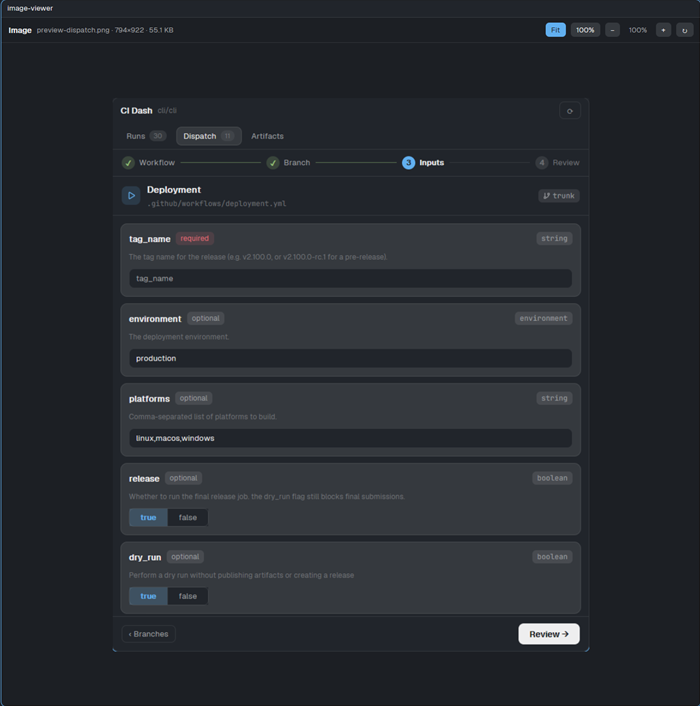

# Image Viewer for the Herdr app



A Herdr app mod that shows one image file: it fits the pane, or you zoom it from 10% to 800% and scroll. It opens PNG, JPEG, GIF, WebP, BMP, SVG, ICO and TIFF files. It never changes the file.

The [CI side panel](../ci-dash-app-panel) opens it when you click an image in the Files panel. You can also open it yourself with `pane.split` or `tab.new` (see below).
[`RECIPE.md`](RECIPE.md) describes the mod in full.

## Install

With an agent (Claude Code or any agent that can read files), paste this prompt:

`Read ~/.config/herdr-app/AGENTS.md, then add this mod: https://github.com/dougcunha/herdr-plugins/tree/main/image-viewer-app`

Or copy the folder yourself. The Herdr app must be running.

```sh
cp -r image-viewer-app/mods/image-viewer ~/.config/herdr-app/mods/image-viewer
herdr-app check ~/.config/herdr-app/mods/image-viewer
```

On Windows PowerShell:

```powershell
Copy-Item -Recurse image-viewer-app\mods\image-viewer "$env:USERPROFILE\.config\herdr-app\mods\image-viewer"
herdr-app check "$env:USERPROFILE\.config\herdr-app\mods\image-viewer"
```

The mod has `"place": "none"`: it adds no panel by itself.

## Open an image

From a shell, in a tab of the Herdr app:

```sh
herdr-app do tab.new --name img --mod image-viewer --props '{"file":"/path/to/picture.png"}'
```

Or beside a terminal: `herdr-app do pane.split --pane <pane id> --direction right --mod image-viewer --props '{"file":"/path/to/picture.png"}'`.

With the side panel, click an image in **Files**. It opens to the right of the tab's terminal. A tab keeps one viewer: a second click replaces the first viewer.

## Props

| Prop | Meaning |
| --- | --- |
| `file` | Absolute path of the image. |
| `fileOn` | Machine of the file. Only `null` (this computer) works today. |
| `zoom` | Start scale, a number such as `1` or `0.5`. Default: Fit. |

## Controls

`Fit` fits the pane and never enlarges the image. `100%` shows the true pixels, with scrollbars. `−` and `+` step through 10, 25, 50, 75, 100, 150, 200, 300, 400 and 800%. `↻` copies the file again, after it changed on disk. A file with no known size (an SVG, or any file on macOS and Linux) has only Fit.

## What it runs, and its limits

- The Herdr app loads only images from its own folder. The mod copies the file to `~/.config/herdr-app/data/image-viewer/` and deletes the copy when the viewer closes. A hot reload of the mod, a change of the layout file or a crash can leave a copy. A sweep at start deletes copies older than 1 day.
- It runs `powershell` (Windows) or `sh`, `rm` and `find` through the app's `exec`. It uses no network.
- Files up to 64 MiB. Images on another machine are not supported yet.
- Tested on Windows only.
