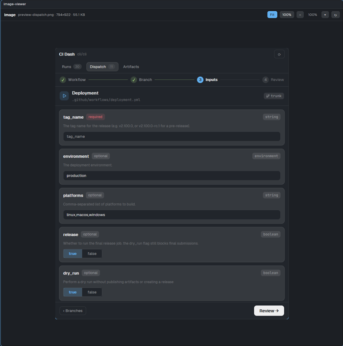

# Image Viewer

A pane for the Herdr app that shows one image file. The Files panel opens it when you click a PNG, JPEG, GIF, WebP, BMP, SVG, ICO or TIFF file. The image fits the pane, or you zoom it from 10% to 800% and scroll. It never changes the file.

## What you see

One pane with two bands, on the `canvas` background (13 px text):

1. **Bar, 42 px, 1 px bottom `border`, 12 px side padding, 8 px gap.** From the left:
   - `Image` in semibold.
   - The file line, 12 px, `muted`, one line, truncated: `<file name> · <width>×<height> · <size>`. The size reads `B`, `KB` or `MB` (`55.1 KB`). The `<width>×<height>` part is missing when the size is unknown. While the file loads, the line shows the file name only.
   - Five buttons, 24 px tall, 9 px side padding, radius 6, 12 px text, `raised` fill: `Fit`, `100%`, `−`, then the current scale in a 44 px wide label (`100%`, 12 px, `muted`), then `+` and `↻`. The active mode button (`Fit` or `100%`) has an `accent` fill and `accent_foreground` text. A disabled button uses `dim` text and has no hover.
2. **Body.** The image on the `canvas` background, 10 px padding.
   - In **Fit** mode the image is centered, never larger than its own pixels.
   - In a zoomed mode the image has its true size times the scale, in a scrolling area (both axes).
   - While loading, `Loading image…` in `dim`. With no file, `Open an image from the Files panel.` in `dim`. An error shows in `ansi1`.

## How it behaves

- **Opening.** The mod reads the props `file` (an absolute path) and `fileOn` (a machine name, or null for this computer). It copies the file, then shows it. Opening needs no click in the viewer.
- **Fit.** The scale is the smaller of 1, `visible width / image width` and `visible height / image height`. The visible area is the pane minus the bar and the padding. The scale label shows it. A pane that is larger than the image shows the image at `100%`.
- **100%.** The image at its true pixel size. The area scrolls when the image is larger than the pane.
- **− and +.** Move to the next step below or above the scale now on screen. The steps are 10%, 25%, 50%, 75%, 100%, 150%, 200%, 300%, 400% and 800%. From Fit they start at the fit scale. Nothing happens past the first or last step.
- **↻.** Copies the file again and shows the new copy. Use it after the file changes on disk. The zoom stays.
- **No size known.** SVG files, every file on macOS and Linux, and any file that `System.Drawing` cannot read have no size for the mod. Then only Fit works: `100%`, `−` and `+` are disabled, the scale label is empty, and the image fits a box of the visible area.
- **Errors.** A file on another machine: `Images on another machine are not supported yet.` A name without an image extension: `This file is not an image the viewer can open.` A file larger than 64 MiB: `This image is larger than 64.0 MB.` A file that cannot be read shows the program's error.
- **Optional prop `zoom`.** A number such as `1` or `0.5` opens the viewer at that scale. It has no effect on a file with no known size.
- **Closing.** When the pane or dialog closes, the mod deletes its copy of the file.

## Built from

- `mod.json`: `{"place": "none", "title": "Image Viewer", "overlay": {"kind": "dialog", "width": 920, "height": 0.85}}`. Create this file **before** `main.js` (see Watch out).
- `main.js`: a `View` that imports `View`, `div`, `image` from `gpui-kit`, `v_flex`, `h_flex` from `gpui-base`, and `props`, `exec`, `appHome`, `window`, `theme` from `herdr`.
  - `init` reads `props()` once and starts the copy with `cx.spawn`.
  - The copy goes to `<appHome>/data/image-viewer/<hash of the path>-<time>.<extension>`. The picture is `image("data/image-viewer/<name>")`.
  - On Windows one `powershell -NoProfile -Command` call checks the size, makes the folder, runs `Copy-Item`, and reads the width and height with `System.Drawing`. It prints `<bytes> <width> <height>`, or `big <bytes>` above 64 MiB. Elsewhere `sh -c` runs `wc -c`, `mkdir -p` and `cp`, and prints `<bytes> 0 0`. Paths go in as quoted arguments, never as shell code.
  - The root element is `v_flex().id("image-viewer")` with `on_size_change`. It stores the visible area (width − 20, height − 62).
  - `close(cx)` deletes the copy (`Remove-Item` or `rm -f`). At start, a sweep deletes copies older than 1 day in `data/image-viewer/`.
- A Files panel can open it with `pane.split {pane, direction: "right", mod: "image-viewer", props: {file, fileOn}}`, or with `openOverlay` when the tab has no terminal. This repository ships no such Files panel.
- Programs that the mod runs with `exec`: `powershell` on Windows; `sh`, `rm` and `find` elsewhere. It uses no network.

## Watch out

- **Disclose this before installing.** The mod runs programs with `exec` and reads any image file you open, from any folder. It writes only under `~/.config/herdr-app/data/image-viewer/`, and it does not use the network.
- **`image()` loads only paths inside the Herdr home.** An absolute path, a `file://` URL and a path with `..` show nothing and report no error. That is why the mod copies the file first. A build that passes the original path shows an empty pane.
- **Create `mod.json` first.** When Herdr sees a new folder in `mods/` without `mod.json`, it docks a copy of the mod at the right edge of the layout and saves it in the layout. A copy with no props shows `Open an image from the Files panel.` With `"place": "none"` nothing is docked. If it happens, remove that block from your layout file.
- **Size of the picture.** Do not size the image with `size_full()`. It stretches the image to the width of the pane and crops it. Give it explicit pixels from the known size.
- **A reload keeps the old copy.** A hot reload of the mod, or a change of the layout file while the viewer is open, restarts the pane without `close`, so its file stays until the next sweep (1 day). A normal close of the pane deletes the file within a second or two.
- **The pane size has the app zoom applied.** `on_size_change` reported the size times the `zoom` of `settings.json` (1.1 gave a Fit 10% too wide, and the image was cropped). The mod divides the size by `settings().zoom`.
- **SVG looks soft when large.** The host draws it as a bitmap and scales it.
- **Limits.** 64 MiB per file. The visible area is estimated from the pane size, so Fit can leave a few pixels of margin.
- **Not tested:** other machines (`fileOn`), macOS and Linux, and WebP, TIFF and ICO files.

## Done when

- `herdr-app check` passes for `mods/image-viewer`.
- `herdr-app do tab.new --name img --mod image-viewer --props '{"file":"<absolute path of a PNG>"}'` shows the bar with the file name, its size in pixels and its weight, and the picture below it. `herdr-app status` lists no error.
- For a PNG smaller than the pane, the scale label reads `100%`. After a click on `−` it reads `75%`, and the picture is smaller.
- For a PNG larger than the pane (for example 3440×1392 in a 1,270 px pane), Fit shows the whole picture with a margin on every side, and the label reads a value below `100%` (for example `33%`). A click on `−` goes to the next step below that value, and a click on `+` to the next step above it.
- The prop `{"zoom": 2}` on a PNG shows `200%` and a scrollable area when the picture is larger than the pane.
- An SVG file opens with `Fit` active and with `100%`, `−` and `+` in `dim`.
- A path that ends in `.txt` shows `This file is not an image the viewer can open.` in red.
- After the pane closes, `data/image-viewer/` has no file of that viewer.
- No panel named `Image` appears in the layout after you add the mod.
