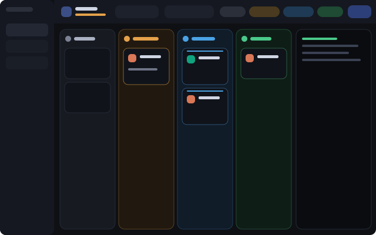

# Kanban

A Herdr app layout where every agent is a card in a column by status:
**Needs you**, **Working**, **Done**, **Idle**. You can hide any column and
change the order of the columns.

A card moves between columns by itself when the agent changes status. Click a
card and the terminal of that agent opens in the panel at the right.

## Quick Start

Copy and paste this prompt to your LLM agent:

`Read ~/.config/herdr-app/AGENTS.md, then add this layout: https://github.com/dougcunha/herdr-plugins/tree/main/kanban-app`

Switch to the layout with `ctrl-shift-l`. Your own layout stays as it was.

## What you see

| Part | What it shows |
| ---- | ------------- |
| Top bar | Title and agent count (the count of "need you" turns amber). A switch **Board / Terminals**, a search box, one **chip per column**, a "this space only" button, a **column width** control (− / +), a **density** button, a **card view** button, a button for the shell, a button for the terminal panel, the **Files** and **Changes** buttons, a button back to the previous layout and **New agent**. |
| Columns | Needs you, Working, Done, Idle, in that order by default. Each has a color, a count, 2 arrow buttons that move it and an eye button that hides it. |
| Cards | Program icon and name, space, the terminal title, the Git branch, the folder, the age, a pin and an "open in its tab" button. A summary view shows 2 lines only. |
| Shell under the board | Optional. A shell of its own (`kanban-shell`), in no tab. A button in the top bar shows or hides it. Drag its top edge to resize. |
| Terminal panel | The terminal of the selected agent (`{ "agent": "focused" }`). Drag its edge to resize. |

## How it behaves

- **Hide a column:** click its chip in the top bar, or the eye button in the column header. A hidden chip is dim with a struck name. The choice is saved. If you hide all of them, a button shows them again.
- **Column order:** click the `<` or `>` arrow in a column header. The column changes place with the next visible column at that side. Hidden columns keep their place. At the edge of the board the arrow is dim. The chips in the top bar follow the same order. The order is saved in `shared("kanban.order")`.
- **Column width:** the − and + buttons set the widest a column may be: 150, 180, 220, 260, 320, 400 px or **Auto** (the columns share the whole board). The columns get narrower with the board, down to 150 px (120 px in compact density). Below that the board scrolls sideways and each column keeps that width. On a super wide monitor, pick 220 or 260 px to get narrow cards. The choice is saved in `shared("kanban.width")`.
- **Density (small monitors):** the button with 4 inward arrows, right of the width control, goes **Auto → Compact → Normal → Auto**. It is lit while the kanban is compact, and its tooltip shows the mode. The choice is saved in `shared("kanban.density")`. **Auto** (the default) makes the top bar compact when it is narrower than 1650 px, and the board compact when it has less than 220 px for each visible column. In compact density:
  - **Done** and **Idle** share one place on the board, one under the other, so the board has 3 places instead of 4. The pair takes the place of the first of the two in the column order.
  - The headers, cards and gaps are smaller. The arrows and the eye of a column header show only while the pointer is on the header, so the name has room.
  - The top bar shows icons with tooltips instead of names: the switch, the column chips (a dot and the count), the panel buttons, the back button and **New agent**. The title and the count go to the tooltip of the board icon. The search box is 150 px.
  - The chips, the tools and the panel buttons are in one row that scrolls sideways when the bar is too narrow. The back button, **New agent** and the window buttons always show.
- **Card view:** the button with a list icon, right of the density button, goes **Auto → Summary → Full → Auto**. It is lit while the view is Summary. The choice is saved in `shared("kanban.cards")`. **Auto** (the default) shows summary cards while the board is compact. A summary card has 2 lines: the program icon, the space name, a pin mark when pinned and the status mark; then the terminal title (or the program and the branch) and the age. While the pointer is on the card, the pin and "open in its tab" buttons take the place of the age. A click selects the agent, as on a full card.
- **Working** cards have a pulsing line on top and a spinner. **Needs you** has a pulsing bell and an amber border. **Done** has a check. **Idle** has a moon.
- **Click a card:** `agent.focus` selects it and opens the terminal panel. A **Done** agent becomes **Idle** after you look at it, so its card moves.
- **Pin** keeps a card at the top of its column. **Open in its tab** goes to the tab of the agent and switches to the **Terminals** view.
- **Files and Changes:** the two buttons in the top bar open Herdr's own Files and Changes mods in a side panel at the right (368 px, drag its edge to resize). Click the same button again to close the panel; click the other one to switch. The panel works in the Board and the Terminals views. It starts closed.
- **Your dock buttons:** the group of buttons also lists every entry of `~/.config/herdr-app/dock/panels.json`, the file the [Dock](../dock-app) layout reads (CI, Repos, Graph, Insights, ...). An entry with `"opens": "panel"` (the default) becomes a block of the same side panel; the Kanban top bar adds it to the layout by itself the first time. `"opens": "tab"` opens a tab with the mod and switches to the Terminals view. `"opens": "command"` runs a Herdr command (a `layout.switch` to the layout you are in is left out). A save of the file shows in the bar at once. If you remove an entry, its block goes too.
- **Back button:** the top bar has a button with the name of the previous layout (for example `main-dock`). It runs `layout.switch`. The previous layout is the one you came from: `shared("layout.previous")`. Without it, the button uses `props.back` of the bar block, then `main`, then the first other layout.
- **Button in the other layout:** with the [Dock](../dock-app) layout, add a command entry to `~/.config/herdr-app/dock/panels.json` and the tab bar shows a **Kanban** button that switches to this layout:
  `{ "id": "kanban", "label": "Kanban", "icon": "mods/kanban/board.svg", "opens": "command", "run": "layout.switch", "args": { "name": "kanban" } }`
  The Dock keeps the name of the layout in `layout.previous` before it switches, so the back button returns there. This needs the `tabs-dock` of this repository (it adds `"opens": "command"`).
- **Shell under the board:** the button with a bottom-panel icon, left of the terminal panel button, shows or hides a shell under the columns. The first time, the mod starts a terminal named `kanban-shell` with `hc run --bg --keep --no-parent`, in the folder of the active space, and adds a block `{ "terminal": "<address>" }` to the layout with `layout.set`. The terminal has no `herdr.space` or `herdr.tab` label, so it is in no tab, and a click on a card does not change it. Hide it and show it again: it is the same shell, with its history. If you type `exit`, click the button 2 times (hide, show) to get a new shell. The default shell of this computer runs; to choose one, add `"shell": ["pwsh", "-NoLogo"]` to the `props` of the `bar` block. You cannot split this shell: it is a layout block, as the terminal panel is.
- **Terminals view** shows the tabs of the current space as in the normal layout, so you can still use plain terminals.
- `agent.next` and `agent.prev` follow the order of the cards on the board.
- Window buttons, drag area and resize work as in the Dock layout (`titlebar: none`).

## What it adds

| Part | What it is |
| ---- | ---------- |
| `layouts/kanban.json` | The window: spaces sidebar, top bar, board plus terminal panel, tab view and status bar. |
| `layouts/kanban.svg` | The picture for the settings screen. |
| `mods/kanban/` | One mod with two parts, chosen by `props.part`: `bar` and `board`. They share state through `shared()`. |

Language: the mod shows English. Add `"lang": "pt"` to the `props` of both
`kanban` blocks in the layout for Portuguese.

## What it does on your machine

- It reads the live data of Herdr (agents, spaces, panes). It stores 7 values in `shared()`: `kanban.hidden`, `kanban.query`, `kanban.scope`, `kanban.width`, `kanban.order`, `kanban.density` and `kanban.cards`.
- It reads `dock/panels.json` and the folder list of `mods/` in the Herdr home, and watches the `dock/` folder.
- It edits `layouts/kanban.json` with the `layout.set` command, to add or remove the side-panel blocks of `panels.json`, and to add the shell block.
- When you show the shell, it runs `hc get kanban-shell`, and `hc run` (or `hc rm` and `hc run`) when that terminal is absent or finished.
- It runs Herdr commands only: `agent.focus`, `terminal.pin`, `tab.select`, `space.select`, `pane.focus`, `pane.zoom`, `layout.select`, `layout.show`, `layout.hide`, `layout.toggle`, `layout.set`, `layout.switch`, `tab.new`, `window.*`, and the `run` of a command entry of `panels.json`.
- It runs no program other than `hc`, and uses no network.

## Limits

- It uses the shipped mods `workspace-chrome`, `spaces`, `workspace-status`, `pane` and `new-menu`.
  They come with Herdr and are not copied here.
- The age on a card is the age of its **tab** (`changed_at` or `working_since`). A tab with 2 agents shows the same age on both.
- Built and tested on Windows with Herdr 0.1.12. Untested: macOS, Linux, remote machines.
- `RECIPE.md` has the full brief to build it from scratch.
