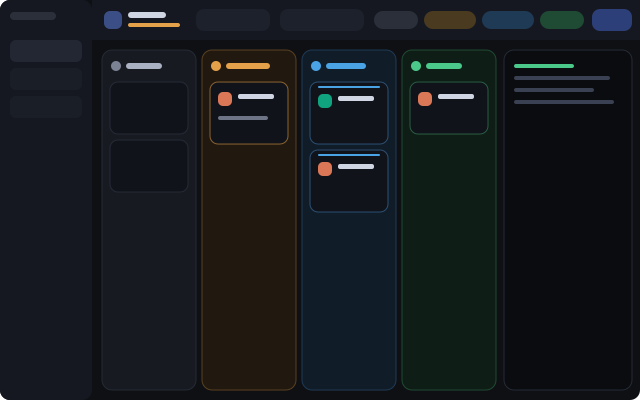

# Kanban

A Herdr app layout where each agent is a card in a status column: Needs you, Working, Done, Idle. The person can hide any column and change the order of the columns. A panel at the right shows the terminal of the selected agent.

## What you see

Left to right, top to bottom (zoom 1):

- **Sidebar**, 240 px, `chrome` background: the shipped `workspace-chrome` brand (46 px), the shipped `spaces` list, the `workspace-chrome` footer (69 px).
- **Top bar**, 52 px, `chrome` background, 1 px bottom border, `window_drag`. From the left: an accent tile with a board icon; the title "Agents" (14 px semibold) over the count ("5 agents", 11 px; amber with "· 2 need you" when an agent is blocked); a switch Board / Terminals (32 px high, pill, active item raised); a search box 220 px wide; 4 column chips; a layers button; a width control (`−`, the value, `+`); a density button (`shrink` icon); a card view button (`list` icon); a shell button; a panel button; the toggles "Files" and "Changes" (icon and name, lit while their panel shows); a "back" button with the name of the previous layout and a swap icon; a primary "New agent" button; window buttons when `window().buttons`.
- **Board**, `canvas` background, 12 px padding and gap. 4 columns of equal width (min 150 px; max set by the width control: 150, 180, 220, 260, 320, 400 px or Auto = no max, `shared("kanban.width")`; the board block has `min: 160` in the layout; the board scrolls sideways only when the columns do not fit at their minimum width, and then each column has exactly that width), in this default order: Needs you, Working, Done, Idle. A column is a 16 px rounded box with a 1 px border and a background tinted 5% with its status color (`theme().idle`, `blocked`, `working`, `done`). Header 48 px: a 26 px tile with an icon (moon, bell, zap, check), the name (13 px semibold), a count badge, a chevron-left and a chevron-right button, an eye-off button.
- **Card**, `background` color, 12 px radius, 1 px border, 12 px padding, 9 px gap: a program tile (28 px, from `program.tile` and `program.icon`), the program name, the space name, a status mark at the right; the terminal title (12 px, 2 lines max); pills for the Git branch (mono), the folder and a named tab; a footer with the age and 2 icon buttons (pin, open).
- **Compact density** (small monitors): column min 120 px, 8 px gap, 12 px radius, header 40 px (8 px padding, 4 px gap, 22 px tile, 12 px name, 20 px buttons), cards with 9 px padding and a 24 px program tile, an empty column box of 64 px. Done and Idle share one place, one under the other (a `column` with the same gap), at the place of the first of the two in the order. The header arrows and eye show only while the pointer is on the header (`on_hover`). In the top bar: no title text (it is the tooltip of the board tile, which turns amber when an agent is blocked), the switch, the chips, the panel buttons, the back button and "New agent" show icons only with tooltips, the search box is 150 px, padding 10 px and gap 6 px.
- **Summary card**, `background` color, 9 px radius, 1 px border, padding 7 × 9 px, 4 px gap: line 1 is a 20 px program tile, the space name (12 px semibold), a pin icon when pinned and the status mark; line 2 (20 px high) is the title, else the program name and the branch (11 px `muted`), and the age (10 px `dim`). While hovered, 2 icon buttons of 20 px (pin, open) replace the age.
- **Shell under the board** (`shell`), optional and absent from the layout file at start: a block `{ "terminal": "<address>" }`, 300 px high (min 120), `background` color, 1 px border, 14 px radius. It shares a column `board-main` (12 px gap, min 160) with the board.
- **Side panel** (`panel`), at the right of the board and the terminal panel, 368 px (min 240, max 1200), hidden at start: a stack `panel-body` with the shipped `files` and `changes` mods.
- **Terminal panel**, 460 px (min 280, max 1100), `background` color, 14 px radius, `md` shadow: `{ "agent": "focused" }`.
- **Status bar**, 28 px, the shipped `workspace-status`.

## How it behaves

- Status to column: `idle` to Idle, `blocked` to Needs you, `working` to Working, `done` to Done. Inside a column: pinned first, then the highest `seq` first.
- **working**: a 2 px line on top of the card pulses (`loop opacity 0.2 to 1, 1400 ms`) and a spinner turns (`spin 900`). **blocked**: the bell pulses (`0.3 to 1, 1100 ms`), the border is amber, the column tile pulses. **done**: a check. **idle**: a moon.
- A column chip toggles the column. Hidden: dim, the name is struck, the dot is hollow. The list of hidden ids is `shared("kanban.hidden")`. With all 4 hidden the board shows a message and a "Show all columns" button.
- The chevrons in a column header swap the column with the next visible column to the left or right. Hidden columns keep their place. At the edge the chevron is dim and does nothing. The order is `shared("kanban.order")`, a list of column ids; unknown ids are dropped and a missing column goes at the end. The chips of the top bar and `setAgentOrder` follow the same order.
- The search box filters on title, program, space, tab and branch (`shared("kanban.query")`). The layers button limits the cards to the active space (`shared("kanban.scope")`: `all` or `space`).
- Click a card: `agent.focus {terminal}`; `layout.show {id:"detail"}` when the panel is hidden. The pin button runs `terminal.pin {terminal, pinned}`. The open button runs `space.select`, `tab.select`, `pane.focus` and `layout.select {stack:"view", child:"tabs-view"}`.
- The switch runs `layout.select {stack:"view", child:"board-view" | "tabs-view"}`. In Terminals view the top bar shows the tab pills of the active space and a `+` that runs `tab.new`.
- The back button first runs `setShared("layout.previous", shared("layout"))`, then `layout.switch {name}`. Its target is, in order: `shared("layout.previous")`, `props.back` (of the `bar` block), `main`, the first other name of `layouts()`; it never is the shown layout. It is hidden when no other layout exists.
- The bar reads `dock/panels.json` (`{ "panels": [ { id, label, icon, mod, props?, opens?, name?, run?, args? } ] }`) and watches the `dock/` folder. An entry is skipped when its id is bad (`a-z`, `0-9`, `-`, up to 32), twice, has no label or icon, or its `mod` is not in `mods/` (a command entry needs `run` instead of `mod`). A broken file keeps the last good list and shows an error toast.
- Buttons of one rounded group, in this order: Files, Changes, then the file's entries as listed (`panel` and `tab`), then its `command` entries. `panel` entries (default) are added as blocks `{ id, type: "block", content: { mod, props? } }` to `panel-body` with `layout.set`, once per file version and layout, and only after the file has loaded; the ids added are kept in `localStorage` (`kanban.injected`) so an entry removed from the file takes its block away. An id that is another node of the layout is skipped. `tab` entries run the "one tab per space" logic (focus the tab that shows the mod, else `tab.new {name, mod}`) and then `layout.select {stack:"view", child:"tabs-view"}`. A `command` entry runs `run(entry.run, entry.args)`; a `layout.switch` first saves `layout.previous`, and one that targets the shown layout is left out.
- The Files and Changes buttons: when `panel` is hidden or shows the other child, run `layout.select {stack:"panel-body", child}` and `layout.show {id:"panel"}`; when it already shows that child, run `layout.hide {id:"panel"}`. The buttons show only for children that `panel-body` has.
- The shell button (a bottom-panel icon, left of the panel button, lit while `shell` shows, a spinner while it works). When `shell` shows: `layout.hide {id:"shell"}`. Otherwise: `hc get kanban-shell --json`; if its `state` is not `live`, `hc rm kanban-shell` (when it exists) and `hc run --bg --json --keep --no-parent --name kanban-shell --label kanban.shell=1 --cwd <active space folder> [-- props.shell...]`. If the `shell` block already shows that address, `layout.show {id:"shell"}`; else `layout.set` with the block pointed at the address, or with the `board` block of `board-view` wrapped in `board-main` together with a new `shell` block. A failure shows an error toast. Why a separate terminal: a test with a `{ "tab": "active" }` block under the board turned it and `detail` black and without input (probably the same terminal in 2 visible blocks), and `pane.split` fails while a layout terminal block has the focus.
- The density button goes `auto` → `compact` → `normal` → `auto` in `shared("kanban.density")` (absent: `auto`). It is lit while the bar is compact; its tooltip names the mode and the next one. Each part measures its own root with `on_size_change` (the reported width is in the same px as `.w()`; `settings().zoom` must not be applied). With `auto`, the bar is compact below 1650 px, and the board is compact below 220 px per visible column plus the gaps. In a compact bar, the chips, the layers, width, density, card view, shell and panel buttons and the panel button group share one row `kb-strip` (`flex_1`, `min_w(0)`, scrolls sideways); the back button, "New agent" and the window buttons stay outside it.
- The card view button goes `auto` → `summary` → `full` → `auto` in `shared("kanban.cards")` (absent: `auto`). It is lit while the value is `summary`. With `auto`, the cards are summary cards while the board is compact.
- The panel button runs `layout.toggle {id:"detail"}`. "New agent" opens the shipped `new-menu` as a popup (250 x 512).
- The board calls `setAgentOrder` with the visible cards, so `agent.next` and `agent.prev` follow the board.

## Built from

- `layouts/kanban.json`: root `row` (`titlebar: none`, `background: canvas`): `sidebar` (column) and `work` (column). `work` holds blocks `bar` and `status`, and a `row` `work-body` (padding 12, gap 12). `work-body` holds the `stack` `view` (active `board-view`) with the `row` `board-view` (gap 12; blocks `board` and `detail`) and the block `tabs-view` (`{ "tab": "active", "pane": {...header: mod "pane"} }`), and the hidden `column` `panel` with the `stack` `panel-body` (`files`, `changes`).
- `mods/kanban/main.js`: one `View`; `props.part` is `bar` or `board`; `props.lang` is `en` or `pt`. `mods/kanban/ui.js`: the icon button, the column chip, the switch, the search box, the pill and the button.
- `mods/kanban/*.svg`: 24 px stroke icons (`currentColor`), `spinner.svg`, and the 4 `win-*.svg` window icons.
- `herdr` functions: `agents`, `spaces`, `panes`, `focused`, `layout`, `window`, `theme`, `props`, `shared`, `setShared`, `run`, `openOverlay`, `setAgentOrder`.

## Watch out

- Write `mod.json` (`{ "place": "none" }`) before `main.js`. Without it Herdr docks a stray copy of the mod into the layout.
- Colors given to `bg` and `border_color` must be `#rrggbb[aa]`. Theme names do not work in a mod. Add alpha with a 2-digit hex suffix.
- A column needs `h_full()`. Without it the columns collapse to the header height and sit in the middle of the board.
- There is no `line_clamp`: the title uses `max_h(34).overflow_hidden()` for 2 lines.
- `props()` inside a later callback can answer for another copy: read the props once in `init(given, cx)`.
- The card age comes from the tab (`changed_at`, `working_since`), not from the agent.
- A row with `overflow_x_scrollbar()` lays out its children at their content width: `flex_1` columns do not share the board, and a long card title makes every column wider. Add the scroll only when the columns do not fit, and give them a fixed `w()` then.
- Text measures its min-content as one line. A pill in the card must shrink (`flex_shrink(1).min_w(0)`), or it goes past the edge of a narrow card.

## Done when

- `herdr-app check ~/.config/herdr-app/mods/kanban` passes and `herdr-app status` shows no errors after `layout.switch {name: "kanban"}`.
- Each agent shows as one card, in the column of its status, with its program icon.
- Clicking a column chip hides and shows that column, and the choice stays after a restart.
- Clicking a card shows its terminal in the right panel.
- The Board / Terminals switch changes the view and the tab pills work.
