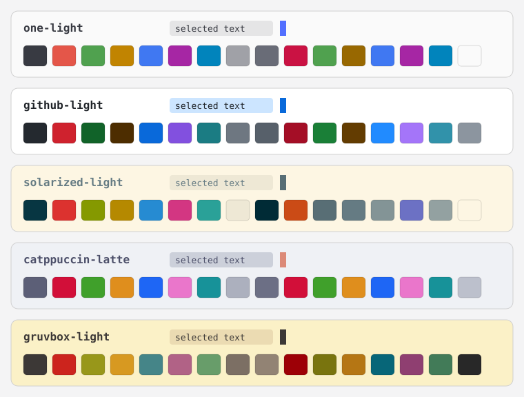

# Light themes for the Herdr app



Five light themes for the Herdr app. The app ships one light theme (`paper`); these add more choices for the light appearance.

| File | Background | Look |
| --- | --- | --- |
| `one-light.json` | `#fafafa` | Neutral gray, from Atom One Light. |
| `github-light.json` | `#ffffff` | White, with the GitHub colors. |
| `solarized-light.json` | `#fdf6e3` | Beige, with the Solarized palette. |
| `catppuccin-latte.json` | `#eff1f5` | Blue-gray, with pastel colors. |
| `gruvbox-light.json` | `#fbf1c7` | Cream, with warm colors. |

Each file sets only the terminal colors (`background`, `foreground`, `selection`, `cursor` and the 16 `ansi` colors). The app derives the panel colors from them. In `gruvbox-light`, ANSI 0 (black) is `#3c3836`, not the background color of the original palette, so black text stays visible.

## Install

With an agent (Claude Code or any agent that can read files), paste this prompt:

`Read ~/.config/herdr-app/AGENTS.md, then copy the themes of https://github.com/dougcunha/herdr-plugins/tree/main/light-themes-app to ~/.config/herdr-app/themes/ without overwriting a file that exists`

Or copy the files yourself. Do not overwrite a theme that you already have.

```sh
cp -n light-themes-app/themes/*.json ~/.config/herdr-app/themes/
```

On Windows PowerShell:

```powershell
Get-ChildItem light-themes-app\themes\*.json | ForEach-Object {
  $dest = Join-Path "$env:USERPROFILE\.config\herdr-app\themes" $_.Name
  if (-not (Test-Path $dest)) { Copy-Item $_.FullName $dest }
}
```

The themes show up in Settings by themselves. No restart is necessary.

## Use a theme

1. Set the light appearance: in Settings, or with `"appearance": "light"` in `~/.config/herdr-app/settings.json`. If `appearance` is absent, the app follows the system.
2. Pick the theme in the theme menu, or run `herdr-app do app.theme --name one-light`.

`app.theme` sets the light half of the layout's theme, because these themes are light. The dark half stays as it was. To follow the system, put both halves in a layout or in `settings.json`:

```json
{ "theme": { "light": "one-light", "dark": "graphite" } }
```

## Limits

- The files contain only colors. They run nothing and use no network.
- Tested on Windows only.
